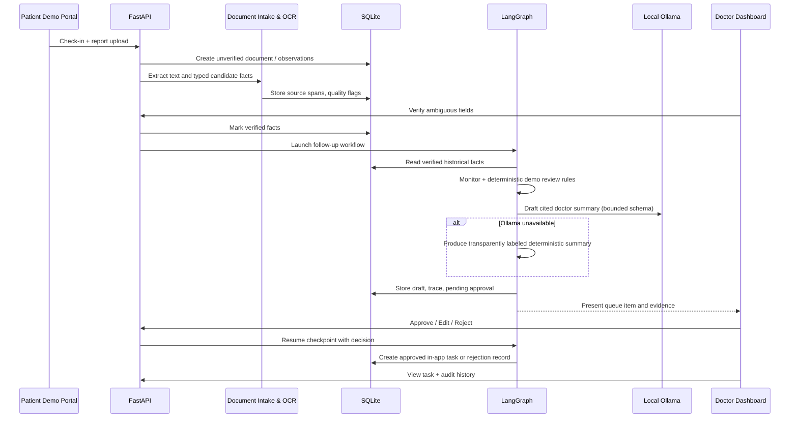

# Architecture Baseline — AI Doctor Follow-Up (Draft v0.1)

This architecture is doctor-centered, local-first and human-controlled. It is an **academic workflow assistant**, not medical decision support cleared for real patient care.

## Logical layers

1. **Browser/UI** — One React app with `/doctor/*` and `/patient/*` role-scoped views; doctor review queue, approvals, patient demo check-ins.
2. **API** — FastAPI authenticated endpoints, typed Pydantic requests and responses, validation, request idempotency, rate/size controls.
3. **Application/domain** — DB repositories, document parsing, observations, deterministic demo review engine, drafting, tasks and audit.
4. **Orchestrator** — LangGraph StateGraph with bounded node transitions, SQLite checkpoints, interrupt/resume and tool allowlist.
5. **Infrastructure** — SQLite database, local uploaded mock documents, local Tesseract, Ollama localhost adapter, in-app notifications.

## Patient-to-doctor end-to-end sequence

## Architecture decisions to confirm during Phase 0
- ADR-0001: Monorepo, single FastAPI service and React frontend rather than microservices.
- ADR-0002: Local Ollama with a deterministic, explicitly labeled no-LLM fallback.
- ADR-0003: SQLite app data and SQLite LangGraph checkpoints, local machine only.
- ADR-0004: Evidence-verified facts, rule-based **review queue** (not medical risk prediction), doctor approval.
- ADR-0005: Real external communications and EHR integrations deferred.

## Data contracts
- No agent receives raw patient data beyond the authorized patient context.
- `ExtractedFact`: source document ID, page or span, raw text, normalized field/value/unit, confidence or quality flag, verification status, verified-by, verified-at.
- `Observation`: patient ID, encounter ID, measured-at timestamp, type, value, unit, source and data validation result.
- `ReviewItem`: patient ID, `DEMO_ONLY` rule ID, supporting fact/observation IDs, generation version, state, doctor decision and reason.
- `SummaryDraft`: factual claims and their citations, model/provider metadata, template/prompt version, review status and approval decision.
- `WorkflowRun`: thread/run ID, node events, checkpoint key, retry count, errors and timestamps.
- Do not use the LLM to select patient identity, bypass approvals, write SQL, invoke arbitrary URLs, or send communications.

## Quality/safety architecture checks
- Negative authorization and wrong-patient tests.
- Duplicate requests and durable resume with no duplicate side effects.
- Prompt injection in documents must not influence instruction hierarchy.
- Unverified OCR values cannot enter trusted summaries or demo review rules.
- User sees actual agent trace and local model status; fallback never masquerades as AI.
- Passwords and patient mock records do not appear in logs; all environment-dependent files are gitignored.

See `docs/roadmap/MASTER_PLAN.md` for binding phased implementation gates and requirements.
