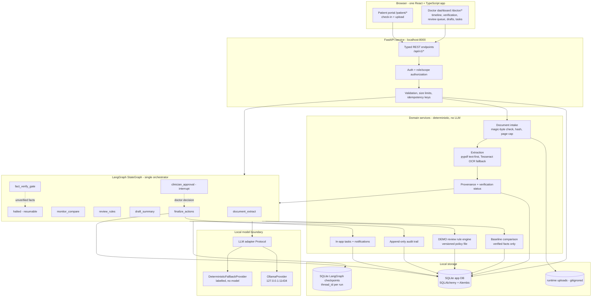
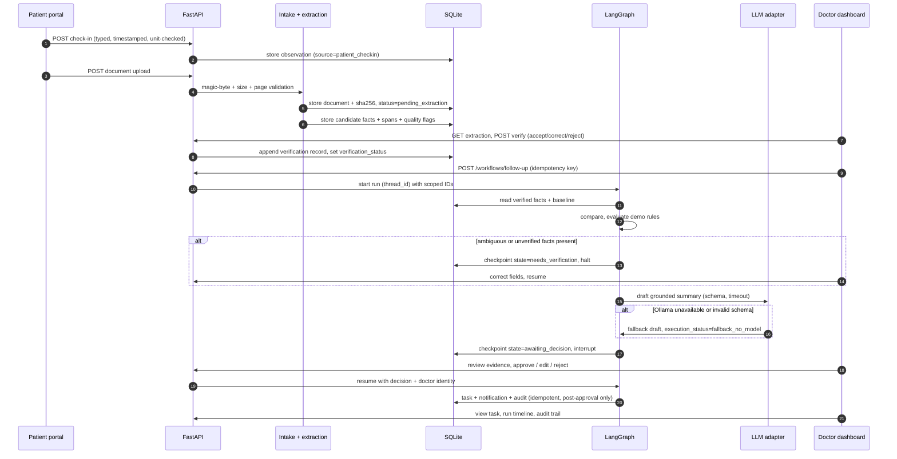

# Architecture Baseline — AI Doctor Follow-Up

| Field | Value |
|---|---|
| Document ID | `ARCH-001` |
| Version | `0.2.0-p0` |
| Status | **IN REVIEW — architecture baseline for owner acceptance** |
| Phase | `P0` (documentation only; no component is implemented) |
| Supersedes | `ARCHITECTURE.md` v0.1 draft (expanded, not contradicted) |

> **EDUCATIONAL / SYNTHETIC DATA / NOT FOR CLINICAL USE.** A local, single-machine academic prototype.
> The doctor makes every clinical decision; the software organizes evidence and drafts prose.

This architecture is doctor-centered, local-first, evidence-first and human-controlled. It exists to make
**one routine outpatient follow-up** observable, resumable and auditable — not to automate medicine.

## 1. Design principles

1. **Evidence before prose.** Structured, source-linked facts are the only input to comparisons, rules, and drafting.
2. **Deterministic where it matters.** Review triggers, permissions, state transitions, and side effects are plain code, never model output.
3. **The model is a tool, not an actor.** One adapter boundary, schema-constrained, timeout-bounded, replaceable by a labelled fallback.
4. **Bounded autonomy.** Five agents, each with a fixed tool allowlist and no direct database, shell, network, or approval capability.
5. **Durable and idempotent.** Every node checkpoints; every finalizing action is guarded by an idempotency key.
6. **Honest uncertainty.** Ambiguous dates, units, OCR text, or conflicting sources stop the pipeline at a human verification gate.
7. **Boring infrastructure.** One API, one React app, SQLite, local files. No cloud, no microservices, no vector DB, no paid inference.

## 2. Finalized logical architecture

The graph node set, edges, retry classification and interrupt semantics are normative in
[`../contracts/STATE_AND_GRAPH_CONTRACT.md`](../contracts/STATE_AND_GRAPH_CONTRACT.md).

## 3. Layers and their contracts

| Layer | Owns | Must not | Contract |
|---|---|---|---|
| Browser/UI | Role-scoped views, evidence display, explicit uncertainty and fallback labels | Compute clinical logic, hide unverified data, call the model directly | `../contracts/API_CONTRACT.md` |
| API | AuthN/AuthZ, typed schemas, request validation, idempotency, size limits, error envelope | Contain clinical thresholds, call Ollama | `../contracts/API_CONTRACT.md` |
| Domain services | Deterministic parsing, comparison, rules, tasks, audit | Invent facts, call the LLM for decisions | `../contracts/DATA_DICTIONARY.md`, `../clinical-safety/DEMO_REVIEW_RULES.md` |
| Orchestrator | Node ordering, state, checkpoint, interrupt/resume, tool dispatch | Let agents chat freely or self-approve | `../contracts/STATE_AND_GRAPH_CONTRACT.md` |
| Agent nodes | One bounded responsibility each, allowlisted tools | Direct SQL, shell, HTTP, approval, prescribing | `../contracts/TOOL_CONTRACTS.md` |
| Model boundary | One method: grounded draft from verified evidence | Decide review items, approve, transmit data elsewhere | `../contracts/LLM_ADAPTER.md` |
| Storage | SQLite app data, checkpoints, local uploads | Hold real patient data; be committed to git | `.gitignore`, `../contracts/DATA_DICTIONARY.md` |

## 4. The five agents — bounded components, not five model servers

All five run as **nodes inside one LangGraph graph** and share one typed state. Only
`doctor_communication` may invoke the model; the rest are deterministic Python. See
[`ADR-0006`](ADR-0006-five-bounded-agents-single-graph.md).

| # | Agent node | Responsibility (one sentence) | Allowed tools | Cannot |
|---|---|---|---|---|
| 1 | `medical_document` | Turn a stored document into candidate structured facts with page/span provenance and quality flags | `get_document_pages`, `extract_document`, `validate_structured_fields` | Accept an ambiguous value as verified; read other patients' documents |
| 2 | `patient_monitoring` | Compare current verified observations against the most recent verified baseline of the same type/unit | `read_observations`, `compare_observations` | Diagnose; impute a missing baseline; convert units silently |
| 3 | `review_priority` | Evaluate versioned deterministic demo rules over verified facts and open review items | `read_verified_facts`, `evaluate_demo_review_rules` | Invent thresholds; rank by clinical risk; use the LLM |
| 4 | `doctor_communication` | Draft a doctor-facing, evidence-linked summary (model or labelled fallback) | `read_verified_facts`, `draft_grounded_summary` | Approve, send, address the patient, or state unsupported facts |
| 5 | `follow_up` | Materialize doctor-approved in-app tasks and notifications, idempotently | `create_in_app_task`, `list_due_tasks` | Contact anyone externally; create a task without an approval record |

Shared-state shape and per-node read/write permissions are defined in
`../contracts/STATE_AND_GRAPH_CONTRACT.md` §3.

## 5. End-to-end sequence (with the doctor gate)

## 6. Role and permission matrix

Legend: **A** = allowed · **C** = allowed only within own patient scope · **S** = allowed only for an assigned patient · **D** = allowed after an explicit doctor decision · **–** = denied (must test as `403`).

| Capability | Doctor `ACT-DOC` | Patient `ACT-PAT` | Demo admin `ACT-ADM` | System worker `ACT-SYS` |
|---|---|---|---|---|
| Sign in / own session | A | A | A (local only) | – (internal identity) |
| List patients | S | – | – | – |
| Read own profile | A | A | A | – |
| Read patient timeline / observations | S | C | – | C (run scope) |
| Create check-in | – | C | – | – |
| Upload document | – | C | – | – |
| Read raw document file | S | C | – | C (run scope) |
| Read extraction result / provenance | S | C (status only, no clinical values) | – | C |
| Verify / correct / reject extracted fact | S | – | – | – (must be human) |
| Read review items | S | – | – | C (write own generated items) |
| Create review item | – (human raises manually only via note) | – | – | A (deterministic rules only) |
| Read draft summary | S | – | – | C (write own draft) |
| Approve / edit / reject decision | S | – | – | – |
| Create follow-up task | – | – | – | D (approved decision only) |
| Complete task | S | – | – | – |
| Read in-app notifications | S | C (no clinical content) | – | A (own generated) |
| Read audit trail | S (own patients) | C (own actions only) | A (local DB/CLI only; no API endpoint in MVP) | A (write only) |
| Seed / reset synthetic demo | – | – | A (local, demo mode) | – |
| Start / resume workflow run | S | C (own check-in triggers intake only) | – | A (internal) |
| Read model/provider metadata | S | – | – | A |
| Send external message | – | – | – | – |
| Prescribe / alter treatment | – | – | – | – |
| Grant a role | – | – | – | – |
| Read another patient's data | – | – | – | – |

Enforcement rules:

1. Authorization is evaluated **server-side per request**, derived from the session identity plus the stored doctor–patient assignment. The UI is never the enforcement point.
2. Denials return `403` (authenticated but out of scope) or `404` (resource does not exist for this actor) with no field-level leakage, and append an audit event.
3. `ACT-SYS` is a process identity, not a login. It can never satisfy a verification or approval check because those require a human actor ID from an authenticated session.
4. No role has an outbound-communication capability; there is no code path to grant one (`REQ-SEC-03`).
5. Patient-visible document status is limited to `received` / `processing` / `needs_attention` — never an interpreted value.

## 7. Data flow and trust boundaries

| Boundary | Trust | Rule |
|---|---|---|
| Browser → API | Untrusted input | Typed validation, size caps, auth per request, CSRF/session policy at P2 |
| Uploaded document bytes | Untrusted content | Magic-byte check, page/timeout caps, text treated as data only, never as instructions (`REQ-SEC-02`) |
| OCR/text layer → facts | Untrusted until verified | Provenance + quality flags + human gate (`REQ-VERIFY-01/02`) |
| Verified facts → rules/draft | Trusted *for demo purposes only* | Only `verification_status=verified` reaches these nodes (`REQ-SEC-04`) |
| API → local Ollama (`127.0.0.1:11434`) | Trusted local process, untrusted output | Schema validation, timeout, size cap, no tool access, no network egress beyond loopback |
| Model output → UI | Displayed, never authoritative | Citations required; unsupported claims dropped; provider metadata shown (`REQ-LLM-02/03`) |
| Runtime data → git | Forbidden | Synthetic fixtures only in repo; uploads/DBs/model weights gitignored (`REQ-SEC-06`) |

## 8. Checkpoint, interrupt and recovery model (summary)

- One graph thread per workflow run; `thread_id` is derived from `run_id`.
- A checkpoint is written after each node; the checkpoint store is a separate SQLite file guarded by `AGENTS.md`.
- Before `finalize_actions` the graph executes an `interrupt`, persisting `state=awaiting_decision`.
- Resumption requires `(run_id, decision, doctor_id, decision_reason)`; the resumed node re-reads verified evidence and never trusts client-supplied clinical facts.
- Side effects are keyed by `idempotency_key = sha256(workflow_version | patient_id | decision_id | action_type | target_id)`; a unique index in SQLite makes a duplicate insert a no-op, and the response stays consistent.
- Crash or restart mid-approval must yield exactly one task and exactly one finalization audit event (`REQ-GRAPH-02/03/04`).

Normative detail: `../contracts/STATE_AND_GRAPH_CONTRACT.md`.

## 9. Clinical-safety architecture checks

These must be demonstrable, not merely claimed:

1. Unverified or rejected facts never reach `compare_observations`, `evaluate_demo_review_rules`, or `draft_grounded_summary`.
2. No task, notification, or finalized summary exists without an approval record referencing a doctor identity.
3. A prompt-injection payload inside a document cannot change tool allowlists, system instructions, approval state, or patient scope.
4. Cross-patient access attempts are denied and audited.
5. Fallback output is labelled at the API and in the UI; it is never presented as model output.
6. Repository scan finds no outbound-messaging dependency or endpoint (`REQ-SEC-03`).
7. The UI, drafts, and fixtures carry the educational/synthetic notice (`REQ-SEC-05`).

Owner-facing wording: `../clinical-safety/CLINICAL_SAFETY.md`. Attack cases: `../clinical-safety/THREAT_MODEL.md`.

## 10. Architecture decisions

| ADR | Decision | Status |
|---|---|---|
| [ADR-0001](ADR-0001-monorepo-single-service.md) | Monorepo with one FastAPI service and one React app; no microservices | Proposed (P0) |
| [ADR-0002](ADR-0002-local-ollama-with-labelled-fallback.md) | Local Ollama behind an adapter, with an explicitly labelled deterministic fallback | Proposed (P0) |
| [ADR-0003](ADR-0003-sqlite-app-and-checkpoints.md) | SQLite for application data and LangGraph checkpoints, single machine only | Proposed (P0) |
| [ADR-0004](ADR-0004-evidence-verified-review-queue.md) | Evidence-verified facts plus a deterministic review queue, never a risk prediction | Proposed (P0) |
| [ADR-0005](ADR-0005-defer-external-comms-and-ehr.md) | Defer external communications and EHR/FHIR integration beyond the MVP | Proposed (P0) |
| [ADR-0006](ADR-0006-five-bounded-agents-single-graph.md) | Five bounded agent nodes inside one orchestrated graph, not five model servers | Proposed (P0) |

ADR status becomes `Accepted` only when the project owner approves the P0 PR.

## 11. Deliberately deferred design work

| Area | Deferred to | Why |
|---|---|---|
| Concrete SQLAlchemy models, migrations, index tuning | P2 | Data dictionary is enough for review now |
| Exact extraction regex/heuristics and OCR preprocessing | P3 | Needs real (synthetic) fixture iteration to tune |
| Numeric demo-rule parameters | P4 | Values must stay arbitrary and reviewable, not implied clinical cut-offs |
| Prompt templates and token budgets | P5 | Depend on the benchmarked local model |
| UI component design system and route guards | P6 | Depends on the finalized API contract |
| Concurrency, multiuser, deployment, backups | Post-graduation | Explicit non-goal (`ASM-06`) |
| Real clinical validation | Out of scope | Cannot be done with synthetic data |

## 12. Consistency notes for the reviewer

- This document, `docs/contracts/*`, `docs/clinical-safety/*`, `docs/evaluation/*`, `docs/demo/*` and
  `docs/roadmap/MASTER_PLAN.md` describe the same workflow; requirement IDs are the join key.
- Where v0.1 `ARCHITECTURE.md` said "Review-Priority Agent", this baseline keeps the name but forbids clinical
  prioritization: it produces deterministic review items whose severity is a **workflow hint** only.
- Where `MASTER_PLAN.md` §2 lists an external web-search agent as excluded, ADR-0005 restates and extends that exclusion.
- Any remaining conflict is recorded in `docs/phase-reports/PHASE_0_REPORT.md` §"Unresolved assumptions".
