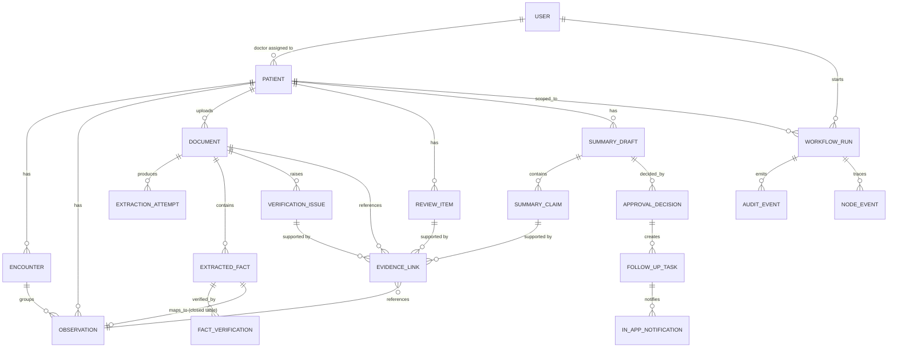

# Data Dictionary — MVP Draft

| Field | Value |
|---|---|
| Document ID | `CTR-DATA-001` |
| Version | `0.4.0-p0` |
| Status | **IN REVIEW — schema proposal; no tables exist** |
| Phase | `P0` (design). Implementation: P2 (core), P3 (documents/facts), P4 (reviews), P5 (workflow), P6 (tasks) |
| Related | `REQ-DATA-01/02/03/04`, `REQ-VERIFY-01/02/03`, `REQ-GRAPH-02`, `REQ-OPS-04`, ADR-0003 |
| Revision | 0.2.0: observation `trust_level` (`P0-R05`), `verification_issue` table for pre-verification blockers (`P0-R03`), `as_of_utc` on runs (`P0-R07`), deterministic task identity (`P0-R04`), document-vs-observation unit split (`P0-R06`) |

Conventions:

- Engine: SQLite via SQLAlchemy 2.x, migrations with Alembic. WAL mode; foreign keys `ON`.
- Primary keys: UUIDv4 stored as 36-char lowercase text (portable, readable in a demo).
- Timestamps: UTC ISO-8601 text (`YYYY-MM-DDTHH:MM:SSZ`), plus a display time zone on the user/patient.
- Booleans: `INTEGER 0/1`; enums: `TEXT` with a `CHECK` constraint and a Python `StrEnum` mirror.
- Money/measurement: `REAL` for values with an explicit unit column; never a unit-less number.
- No real patient data. Every row in every table is synthetic or generated by the demo run.
- Table names are `snake_case` singular (`patient`, `observation`, …).

## 1. Entity relationship overview

## 2. Tables

### 2.1 `user`

| Column | Type | Constraints | Notes |
|---|---|---|---|
| `id` | TEXT(36) | PK | UUIDv4 |
| `username` | TEXT(64) | UNIQUE, NOT NULL, `^[a-z0-9_.-]{3,64}$` | Seeded synthetic accounts |
| `display_name` | TEXT(80) | NOT NULL | Fictitious |
| `role` | TEXT(16) | NOT NULL, CHECK in (`doctor`,`patient`,`demo_admin`) | No role escalation path |
| `password_hash` | TEXT(255) | NOT NULL | Salted hash (argon2/bcrypt decided at P2); never logged |
| `patient_id` | TEXT(36) | NULL, FK `patient.id` ON DELETE RESTRICT | Required iff `role='patient'` |
| `timezone` | TEXT(64) | NOT NULL DEFAULT `'Africa/Cairo'` | Display only |
| `is_active` | INTEGER | NOT NULL DEFAULT 1 | |
| `created_at` | TEXT(20) | NOT NULL | UTC |
| `last_login_at` | TEXT(20) | NULL | |

Indexes: `ux_user_username (username)`; `ix_user_role (role)`.

### 2.2 `patient`

| Column | Type | Constraints | Notes |
|---|---|---|---|
| `id` | TEXT(36) | PK | Deterministic fixture IDs (`REQ-OPS-01`) |
| `display_name` | TEXT(80) | NOT NULL | Clearly fictitious (`Demo Patient A`) |
| `date_of_birth` | TEXT(10) | NULL | Synthetic |
| `sex_at_birth` | TEXT(16) | NULL, CHECK in (`female`,`male`,`unknown`) | Demo attribute only; never used for scoring |
| `assigned_doctor_id` | TEXT(36) | NOT NULL, FK `user.id` ON DELETE RESTRICT | Drives `S` scope in the permission matrix |
| `external_ref` | TEXT(40) | UNIQUE, NULL | Synthetic demo reference, e.g. `DEMO-A-001`; never a real MRN |
| `data_source` | TEXT(24) | NOT NULL DEFAULT `'synthetic_fixture'` | Guards against real data (`REQ-SEC-06`) |
| `created_at` / `updated_at` | TEXT(20) | NOT NULL | |

### 2.3 `encounter`

| Column | Type | Constraints | Notes |
|---|---|---|---|
| `id` | TEXT(36) | PK | |
| `patient_id` | TEXT(36) | NOT NULL, FK `patient.id` | |
| `encounter_date` | TEXT(10) | NOT NULL | Date of the synthetic visit |
| `encounter_type` | TEXT(32) | NOT NULL DEFAULT `'routine_follow_up'` | Only type in MVP |
| `note` | TEXT(1000) | NULL | Doctor-authored synthetic note; not model-generated |
| `created_at` | TEXT(20) | NOT NULL | |

Index: `ix_encounter_patient_date (patient_id, encounter_date DESC)`.

### 2.4 `document`

| Column | Type | Constraints | Notes |
|---|---|---|---|
| `id` | TEXT(36) | PK | |
| `patient_id` | TEXT(36) | NOT NULL, FK `patient.id` | Uploader scope enforced in service |
| `uploaded_by_user_id` | TEXT(36) | NOT NULL, FK `user.id` | |
| `original_filename` | TEXT(255) | NOT NULL | Sanitized; no path separators |
| `stored_path` | TEXT(255) | NOT NULL | Relative to gitignored runtime dir; never committed |
| `mime_type` | TEXT(64) | NOT NULL, CHECK in (`application/pdf`,`image/png`,`image/jpeg`) | From magic bytes |
| `sha256` | TEXT(64) | NOT NULL | `^[0-9a-f]{64}$` |
| `size_bytes` | INTEGER | NOT NULL, CHECK `0 < size_bytes <= 10485760` | 10 MiB cap |
| `page_count` | INTEGER | NULL, CHECK `page_count <= 20` | Parsed at intake |
| `extraction_status` | TEXT(24) | NOT NULL, CHECK in (`pending_extraction`,`extracted`,`needs_verification`,`verified`,`failed`) | |
| `failure_code` | TEXT(48) | NULL | Mirrors tool error codes |
| `uploaded_at` | TEXT(20) | NOT NULL | |

Indexes: `ix_document_patient (patient_id)`; `ux_document_sha_patient (patient_id, sha256)` (duplicate-upload detection).

### 2.5 `extraction_attempt`

| Column | Type | Constraints | Notes |
|---|---|---|---|
| `id` | TEXT(36) | PK | |
| `document_id` | TEXT(36) | NOT NULL, FK `document.id` | |
| `path` | TEXT(16) | NOT NULL, CHECK in (`pypdf`,`tesseract`,`manual`) | Provenance of the extraction route (`REQ-ING-02`) |
| `preprocessing` | TEXT(20) | NOT NULL DEFAULT `'none'`, CHECK in (`none`,`grayscale_upscale`) | Deterministic preprocessing applied before OCR; the triage input (`P0-R08`) |
| `engine_confidence` | REAL | NULL, CHECK `0 ≤ engine_confidence ≤ 1` | **Engine-reported only.** NULL when the engine reports none — never estimated or back-filled |
| `text_char_count` | INTEGER | NOT NULL DEFAULT 0, CHECK `≥ 0` | Text-layer coverage signal used by `extraction_triage` |
| `page_from` / `page_to` | INTEGER | NOT NULL | |
| `succeeded` | INTEGER | NOT NULL | |
| `error_code` | TEXT(48) | NULL | |
| `duration_ms` | INTEGER | NOT NULL | |
| `tool_version` | TEXT(64) | NULL | Runtime-reported version, recorded at execution (not claimed in P0) |
| `created_at` | TEXT(20) | NOT NULL | |

Indexes: `ix_attempt_document (document_id, created_at DESC)`; `ix_attempt_doc_conf (document_id, engine_confidence)`.
`extraction_attempt` rows are the **only** typed source for `TriageDetail`; the triage node never inspects raw
document text to decide a path (`P0-R08`).

### 2.6 `extracted_fact` (candidate, unverified by construction)

| Column | Type | Constraints | Notes |
|---|---|---|---|
| `id` | TEXT(36) | PK | |
| `document_id` | TEXT(36) | NOT NULL, FK `document.id` | |
| `patient_id` | TEXT(36) | NOT NULL, FK `patient.id` | Denormalized for scope checks |
| `field_name` | TEXT(24) | NOT NULL, CHECK in (`report_date`,`test_name`,`value`,`unit`,`reference_text`) | Declared field set only (`REQ-ING-03`) |
| `raw_text` | TEXT(300) | NOT NULL | Exactly as extracted |
| `normalized_value` | TEXT(120) | NULL | Deterministic normalization only |
| `unit` | TEXT(32) | NULL | Document unit list (`mmHg`, `bpm`, `mg/dL`, `g/dL`, `%`); a document unit is text, not an `Observation` unit (`P0-R06`) |
| `page_index` | INTEGER | NOT NULL, CHECK `>= 0` | |
| `char_start` / `char_end` | INTEGER | NOT NULL, CHECK `char_end >= char_start` | Span in the page/OCR text |
| `quality_flags` | TEXT(200) | NOT NULL | JSON array of `QualityFlag` values |
| `confidence` | REAL | NULL, CHECK `0 <= confidence <= 1` | OCR confidence when available; NULL for text-layer |
| `verification_status` | TEXT(16) | NOT NULL DEFAULT `'pending'`, CHECK in (`pending`,`verified`,`rejected`) | |
| `created_at` | TEXT(20) | NOT NULL | |

Indexes: `ix_fact_document (document_id)`; `ix_fact_status (patient_id, verification_status)`;
CHECK `raw_text <> ''`; CHECK `char_start >= 0`.

### 2.7 `fact_verification` (append-only human decision log)

| Column | Type | Constraints | Notes |
|---|---|---|---|
| `id` | TEXT(36) | PK | |
| `fact_id` | TEXT(36) | NOT NULL, FK `extracted_fact.id` | |
| `decision` | TEXT(16) | NOT NULL, CHECK in (`verified`,`rejected`,`corrected`) | |
| `previous_value` | TEXT(120) | NULL | Before/after audit (`REQ-AUDIT-01`) |
| `new_value` | TEXT(120) | NULL | |
| `new_unit` | TEXT(32) | NULL | |
| `reason` | TEXT(300) | NULL | |
| `verified_by_user_id` | TEXT(36) | NOT NULL, FK `user.id` | Must be `role='doctor'` (service + CHECK trigger) |
| `decided_at` | TEXT(20) | NOT NULL | |

Index: `ix_factver_fact (fact_id, decided_at DESC)`. No UPDATE/DELETE path — append only.

### 2.8 `observation`

| Column | Type | Constraints | Notes |
|---|---|---|---|
| `id` | TEXT(36) | PK | |
| `patient_id` | TEXT(36) | NOT NULL, FK `patient.id` | |
| `encounter_id` | TEXT(36) | NULL, FK `encounter.id` | |
| `measure_type` | TEXT(24) | NOT NULL, CHECK in (`systolic_bp`,`diastolic_bp`,`heart_rate`,`glucose`) | Unit allowlist enforced per type |
| `value` | REAL | NOT NULL, CHECK `value > 0` | |
| `unit` | TEXT(16) | NOT NULL, CHECK in (`mmHg`,`bpm`,`mg/dL`) | No unit-less rows (`REQ-DATA-02`) |
| `measured_at` | TEXT(20) | NOT NULL | Must be ≤ now + 5 min (clock-skew guard) |
| `source` | TEXT(24) | NOT NULL, CHECK in (`patient_checkin`,`verified_document`,`seed_fixture`) | |
| `source_fact_id` | TEXT(36) | NULL, FK `extracted_fact.id` | Set when derived from a verified document |
| `validation` | TEXT(16) | NOT NULL DEFAULT `'ok'`, CHECK in (`ok`,`ok_with_warning`,`rejected`) | Data check only (schema, unit, plausibility) — **not** a human verification |
| `trust_level` | TEXT(28) | NOT NULL, CHECK in (`self_reported_validated`,`doctor_verified`) | Provenance class (`REQ-DATA-04`) |
| `verified_by_user_id` | TEXT(36) | NULL, FK `user.id` | Required iff `trust_level='doctor_verified'`; must be role `doctor` |
| `verified_at` | TEXT(20) | NULL | Required iff `trust_level='doctor_verified'` |
| `note` | TEXT(500) | NULL | Patient's own words, quoted only |
| `created_at` | TEXT(20) | NOT NULL | |
| `created_by_user_id` | TEXT(36) | NULL | |

Indexes: `ix_obs_patient_type_time (patient_id, measure_type, measured_at DESC)`; `ix_obs_trust (patient_id, trust_level)`;
`ux_obs_source_fact (source_fact_id)` **UNIQUE** (SQLite treats NULLs as distinct, so check-in rows are unaffected) —
one observation per verified fact, so replaying a verification cannot duplicate a measurement (`REQ-DATA-05`, `P0-R10`).

CHECK constraints:
- `source='verified_document'` requires `source_fact_id IS NOT NULL` **and** `trust_level='doctor_verified'`.
- `trust_level='doctor_verified'` ⇔ `verified_by_user_id IS NOT NULL AND verified_at IS NOT NULL`.
- `trust_level='self_reported_validated'` requires both verification columns to be `NULL` — a check-in cannot
  claim doctor verification (`P0-R05`).
- `validation='rejected'` rows are retained for audit but are inadmissible to comparisons and rules (`REQ-DATA-04`).

### 2.8a `verification_issue` (pre-verification blockers)

| Column | Type | Constraints | Notes |
|---|---|---|---|
| `id` | TEXT(36) | PK | |
| `patient_id` | TEXT(36) | NOT NULL, FK `patient.id` | |
| `workflow_run_id` | TEXT(36) | NULL, FK `workflow_run.id` | NULL only for pre-run document intake views |
| `document_id` | TEXT(36) | NULL, FK `document.id` | |
| `issue_type` | TEXT(8) | NOT NULL, CHECK in (`VI-001`…`VI-006`) | No rule ID, no severity |
| `reason_code` | TEXT(64) | NOT NULL | e.g. `unit_missing_or_unsupported` |
| `blocking` | INTEGER | NOT NULL DEFAULT 1, CHECK `blocking = 1` | Structural: these issues always block |
| `message` | TEXT(240) | NOT NULL | Neutral wording from `DEMO_REVIEW_RULES.md` §6.1 |
| `state` | TEXT(12) | NOT NULL DEFAULT `'open'`, CHECK in (`open`,`resolved`,`superseded`) | |
| `created_at` | TEXT(20) | NOT NULL | |

Index: `ix_vi_document_state (document_id, state)`; `ix_vi_run (workflow_run_id)`.
No `rule_id` column exists — a `VerificationIssue` can never be stored as a review item (`P0-R03`).

### 2.9 `review_item`

| Column | Type | Constraints | Notes |
|---|---|---|---|
| `id` | TEXT(36) | PK | |
| `patient_id` | TEXT(36) | NOT NULL, FK `patient.id` | |
| `workflow_run_id` | TEXT(36) | NOT NULL, FK `workflow_run.id` | |
| `rule_id` | TEXT(8) | NOT NULL, CHECK `^DR-\d{3}$` and in (`DR-001`,`DR-003`,`DR-005`,`DR-006`,`DR-008`,`DR-009`) | Deterministic post-verification rule (`REQ-RULE-01`); retired IDs `DR-002/004/007/010` are rejected |
| `reason_code` | TEXT(64) | NOT NULL | e.g. `bp_delta_above_demo_parameter` |
| `workflow_hint` | TEXT(24) | NOT NULL, CHECK in (`data_quality`,`verification_needed`,`change_to_review`) | Ordering metadata, not severity |
| `trust_basis` | TEXT(16) | NOT NULL, CHECK in (`self_reported`,`doctor_verified`,`mixed`) | Provenance class of the evidence behind the item (`REQ-DATA-04`) |
| `message` | TEXT(240) | NOT NULL | Neutral wording; no clinical interpretation |
| `policy_version` | TEXT(24) | NOT NULL | |
| `demo_only` | INTEGER | NOT NULL DEFAULT 1, CHECK `demo_only = 1` | Structural honesty |
| `dedupe_key` | TEXT(64) | NOT NULL | `sha256(patient_id \| rule_id \| sorted evidence keys \| trust_basis)`; UNIQUE with `workflow_run_id` |
| `state` | TEXT(16) | NOT NULL DEFAULT `'open'`, CHECK in (`open`,`decided`,`superseded`) | |
| `created_at` | TEXT(20) | NOT NULL | |

Indexes: `ux_review_dedupe (workflow_run_id, dedupe_key)`; `ix_review_patient_state (patient_id, state)`.

### 2.10 `evidence_link` (polymorphic evidence join)

| Column | Type | Constraints | Notes |
|---|---|---|---|
| `id` | TEXT(36) | PK | |
| `owner_type` | TEXT(24) | NOT NULL, CHECK in (`review_item`,`verification_issue`,`summary_claim`) | |
| `owner_id` | TEXT(36) | NOT NULL | |
| `kind` | TEXT(24) | NOT NULL, CHECK in (`document_span`,`observation`,`checkin_note`) | Mirrors `ProvenanceRef.kind` |
| `document_id` | TEXT(36) | NULL, FK `document.id` | Required for `document_span` |
| `observation_id` | TEXT(36) | NULL, FK `observation.id` | Required for `observation` |
| `page_index` | INTEGER | NULL | |
| `char_start` / `char_end` | INTEGER | NULL | |
| `created_at` | TEXT(20) | NOT NULL | |

CHECK: exactly one of (`document_id`+span, `observation_id`) populated per `kind`.
Index: `ix_evidence_owner (owner_type, owner_id)`.

### 2.11 `summary_draft`

| Column | Type | Constraints | Notes |
|---|---|---|---|
| `id` | TEXT(36) | PK | |
| `patient_id` | TEXT(36) | NOT NULL, FK `patient.id` | |
| `workflow_run_id` | TEXT(36) | NOT NULL, FK `workflow_run.id` | |
| `provider` | TEXT(24) | NOT NULL, CHECK in (`ollama`,`deterministic_fallback`) | Honest provenance (`REQ-LLM-03`) |
| `model` | TEXT(80) | NULL | NULL for fallback; never a guess |
| `execution_status` | TEXT(32) | NOT NULL, CHECK in (`model_ok`,`model_invalid_schema`,`model_timeout`,`model_unavailable`,`fallback_no_model`) | |
| `prompt_version` | TEXT(24) | NOT NULL | |
| `latency_ms` | INTEGER | NULL | Measured only when a call happened |
| `body` | TEXT(4000) | NOT NULL | Doctor-facing; always contains the disclaimer |
| `status` | TEXT(16) | NOT NULL DEFAULT `'draft'`, CHECK in (`draft`,`approved`,`edited`,`rejected`) | |
| `created_at` / `updated_at` | TEXT(20) | NOT NULL | |

CHECK: `(provider='ollama') = (model IS NOT NULL)`; `status='approved'` requires an `approval_decision` row.

### 2.12 `summary_claim`

| Column | Type | Constraints | Notes |
|---|---|---|---|
| `id` | TEXT(36) | PK | |
| `draft_id` | TEXT(36) | NOT NULL, FK `summary_draft.id` ON DELETE CASCADE | |
| `claim_index` | INTEGER | NOT NULL | Ordering |
| `text` | TEXT(400) | NOT NULL | One verifiable statement |
| `supported` | INTEGER | NOT NULL DEFAULT 1 | 0 only if explicitly listed in `not_asserted` |
| `created_at` | TEXT(20) | NOT NULL | |

UNIQUE `(draft_id, claim_index)`. Every row with `supported=1` must have ≥ 1 `evidence_link` (`REQ-LLM-02`).

### 2.13 `approval_decision`

| Column | Type | Constraints | Notes |
|---|---|---|---|
| `id` | TEXT(36) | PK | |
| `workflow_run_id` | TEXT(36) | NOT NULL, FK `workflow_run.id` | |
| `draft_id` | TEXT(36) | NOT NULL, FK `summary_draft.id` | |
| `doctor_id` | TEXT(36) | NOT NULL, FK `user.id` | Must be role `doctor` |
| `decision` | TEXT(12) | NOT NULL, CHECK in (`approve`,`edit`,`reject`) | |
| `edited_body` | TEXT(4000) | NULL | Required when `decision='edit'` |
| `reason` | TEXT(500) | NULL | Strongly encouraged on reject |
| `decided_at` | TEXT(20) | NOT NULL | |

UNIQUE `(workflow_run_id)` — one final decision per run (`REQ-GRAPH-03`).
CHECK: `decision='edit' ⇒ edited_body IS NOT NULL`.

### 2.14 `follow_up_task`

| Column | Type | Constraints | Notes |
|---|---|---|---|
| `id` | TEXT(36) | PK | |
| `patient_id` | TEXT(36) | NOT NULL, FK `patient.id` | |
| `approval_decision_id` | TEXT(36) | NOT NULL, FK `approval_decision.id` | No task without a decision (`REQ-TASK-01`) |
| `title` | TEXT(160) | NOT NULL | |
| `note` | TEXT(500) | NULL | |
| `due_date` | TEXT(10) | NULL | Doctor-chosen |
| `status` | TEXT(12) | NOT NULL DEFAULT `'open'`, CHECK in (`open`,`completed`,`cancelled`) | |
| `idempotency_key` | TEXT(64) | NOT NULL UNIQUE | `action_key = sha256(workflow_version \| patient_id \| approval_decision_id \| "followup_task" \| "slot:1")`; `id` is `uuid5(TASK_NAMESPACE, action_key)` so a retry recomputes the same row (`REQ-GRAPH-04`, `P0-R04`) |
| `created_at` / `completed_at` | TEXT(20) | NOT NULL / NULL | |

CHECK: `status='completed' ⇒ completed_at IS NOT NULL`.
Index: `ix_task_patient_status (patient_id, status, due_date)`.

### 2.15 `in_app_notification`

| Column | Type | Constraints | Notes |
|---|---|---|---|
| `id` | TEXT(36) | PK | |
| `recipient_user_id` | TEXT(36) | NOT NULL, FK `user.id` | Doctor in the MVP |
| `task_id` | TEXT(36) | NULL, FK `follow_up_task.id` | |
| `text` | TEXT(240) | NOT NULL | No clinical interpretation |
| `read_at` | TEXT(20) | NULL | |
| `idempotency_key` | TEXT(64) | NOT NULL UNIQUE | One per decision |
| `created_at` | TEXT(20) | NOT NULL | |

There is no transport column, no provider column, and no "sent" status — by design (`ADR-0005`).

### 2.16 `workflow_run`

| Column | Type | Constraints | Notes |
|---|---|---|---|
| `id` | TEXT(36) | PK | Equals LangGraph `thread_id` |
| `patient_id` | TEXT(36) | NOT NULL, FK `patient.id` | |
| `doctor_id` | TEXT(36) | NOT NULL, FK `user.id` | |
| `workflow_version` | TEXT(12) | NOT NULL | |
| `state_schema_version` | TEXT(12) | NOT NULL | |
| `policy_version` | TEXT(24) | NOT NULL | |
| `as_of_utc` | TEXT(20) | NOT NULL | Injected evaluation clock used by every time-dependent rule (`REQ-OPS-04`) |
| `status` | TEXT(24) | NOT NULL | Mirrors `RunStatus` |
| `current_node` | TEXT(32) | NULL | |
| `halt_reason` | TEXT(32) | NULL | |
| `idempotency_key` | TEXT(64) | NOT NULL UNIQUE | Repeat start returns this run |
| `retry_counts` | TEXT(500) | NOT NULL DEFAULT `'{}'` | JSON, capped |
| `mapping_version` | TEXT(16) | NOT NULL, `CHECK (mapping_version LIKE 'map-%.%.%')` | Version of the closed fact → observation mapping used by the run (`REQ-DATA-05`). Format `map-<major>.<minor>.<patch>`; the exact form is app-validated against `^map-\d+\.\d+\.\d+$` (SQLite cannot express a regex, so the CHECK is a shape guard only). Not exposed by the API in the MVP — it is persisted for replay/explanation (`P0-R12`) |
| `checkpoint_ref` | TEXT(120) | NULL | Last checkpoint id/label — **advisory only**, never used to decide status (`P0-R09`) |
| `started_at` / `updated_at` / `ended_at` | TEXT(20) | NOT NULL / NOT NULL / NULL | |

This table is the **single source of truth** for run status (`P0-R09`). The LangGraph checkpoint DB lives in a
different SQLite file and cannot join an app-DB transaction; `finalizing`/`completed` transitions are committed
here, and on restart the service reconciles against these rows (`STATE_AND_GRAPH_CONTRACT.md` §7.3).

### 2.17 `audit_event` (append-only)

| Column | Type | Constraints | Notes |
|---|---|---|---|
| `id` | TEXT(36) | PK | |
| `event_type` | TEXT(48) | NOT NULL | e.g. `workflow.run.started`, `fact.verified`, `approval.recorded`, `access.denied` |
| `actor_type` | TEXT(16) | NOT NULL, CHECK in (`user`,`system`,`demo_admin`) | |
| `actor_id` | TEXT(36) | NULL | NULL only for pure system events |
| `patient_id` | TEXT(36) | NULL | Scoping for doctor views |
| `workflow_run_id` | TEXT(36) | NULL | |
| `subject_type` | TEXT(32) | NULL | e.g. `document`, `extracted_fact`, `task` |
| `subject_id` | TEXT(36) | NULL | |
| `outcome` | TEXT(12) | NOT NULL, CHECK in (`ok`,`denied`,`error`) | |
| `safe_detail` | TEXT(500) | NULL | **No document text, no passwords, no tokens** (`REQ-AUDIT-02`) |
| `idempotency_key` | TEXT(64) | NOT NULL UNIQUE | Replay cannot duplicate |
| `created_at` | TEXT(20) | NOT NULL | |

Indexes: `ix_audit_patient_time (patient_id, created_at DESC)`; `ix_audit_run (workflow_run_id, created_at)`.
No UPDATE/DELETE in the application layer; only the demo reset removes rows (whole DB rebuild).

### 2.18 `node_event` (typed graph trace)

| Column | Type | Constraints | Notes |
|---|---|---|---|
| `id` | TEXT(36) | PK | |
| `workflow_run_id` | TEXT(36) | NOT NULL, FK `workflow_run.id` | |
| `sequence` | INTEGER | NOT NULL, CHECK `≥ 0` | Monotonic per run; `UNIQUE (workflow_run_id, sequence)` |
| `node` | TEXT(48) | NOT NULL | Matches the node table (`STATE_AND_GRAPH_CONTRACT.md` §4.1) |
| `attempt` | INTEGER | NOT NULL DEFAULT 1, CHECK `1 ≤ attempt ≤ 5` | Retry index of that node |
| `started_at` / `ended_at` | TEXT(20) | NOT NULL / NULL | |
| `outcome` | TEXT(12) | NULL, CHECK in (`ok`,`halted`,`interrupted`,`retried`,`failed`) | |
| `tools_called` | TEXT(300) | NOT NULL DEFAULT `'[]'` | JSON array of tool **names** only, ≤ 6 |
| `detail_kind` | TEXT(12) | NULL, CHECK in (`triage`,`validation`,`gate`,`finalize`) | NULL iff the node makes no bounded decision |
| `triage_path` | TEXT(24) | NULL, CHECK in (`text_layer`,`ocr_direct`,`ocr_preprocess_retry`,`flag_for_human`) | `detail_kind='triage'` only |
| `triage_reason` | TEXT(28) | NULL, CHECK in (`text_layer_available`,`confidence_ok`,`low_confidence`,`ocr_transient_error`,`retry_exhausted`) | |
| `attempt_index` | INTEGER | NULL, CHECK `1 ≤ attempt_index ≤ 2` | Bounded retry budget |
| `engine_confidence` | REAL | NULL, CHECK `0 ≤ engine_confidence ≤ 1` | Engine-reported or NULL |
| `preprocessing_applied` | INTEGER | NULL, CHECK in (0,1) | |
| `validation_outcome` | TEXT(20) | NULL, CHECK in (`accept`,`repair_requested`,`fallback_selected`) | |
| `violation_codes` | TEXT(300) | NULL | JSON array of the enum codes only, ≤ 6 |
| `gate_decision` | TEXT(10) | NULL, CHECK in (`proceed`,`halt`) | |
| `blocking_fact_count` | INTEGER | NULL, CHECK `0 ≤ blocking_fact_count ≤ 40` | |
| `finalize_decision` | TEXT(10) | NULL, CHECK in (`approve`,`edit`,`reject`) | |
| `task_created` / `notification_created` | INTEGER | NULL, CHECK in (0,1) | |
| `created_at` | TEXT(20) | NOT NULL | |

Indexes: `ix_node_event_run (workflow_run_id, sequence)`.

CHECK constraints:
- `detail_kind='triage'` ⇒ `triage_path`, `triage_reason`, `attempt_index` NOT NULL and all validation/gate/finalize columns NULL; `detail_kind='validation'`/`'gate'`/`'finalize'` symmetric.
- `detail_kind IS NULL` ⇒ every detail column NULL (a node that makes no bounded decision cannot smuggle metadata).
- No column stores document text, raw values, patient names or model output — only enums, IDs, counts and
  probabilities (`REQ-AUDIT-02`, `P0-R08`). The trace has no free-text column at all.

`GET /api/v1/workflows/{run_id}/trace` reads these rows; the same structs are the `TraceEvent` schema in
`openapi.phase0.yaml` and `NodeEvent` in `STATE_AND_GRAPH_CONTRACT.md` §3.

## 3. Units and validation rules

### 3.1 Observation units (comparable measurements)

| Measure | Allowed unit | Demo plausibility band (data-quality heuristic, **not** a clinical range) | Notes |
|---|---|---|---|
| `systolic_bp` | `mmHg` | 50–300 | Outside band → `ok_with_warning`, never a diagnosis |
| `diastolic_bp` | `mmHg` | 20–200 | |
| `heart_rate` | `bpm` | 20–250 | |
| `glucose` | `mg/dL` | 10–900 | Unit `mmol/L` **rejected at intake** in MVP with a typed error |

### 3.2 Document units (extracted report text)

`ExtractedFact.unit` is wider than the observation allowlist because a report may legitimately print other units:
`mmHg`, `bpm`, `mg/dL`, `g/dL`, `%`. These are **strings in document context**; they never become an
`Observation` unit unless the closed mapping table in §3.3 maps both the test name and the unit. A hemoglobin value in `g/dL` is therefore a verified fact used in the summary and
**not** a comparable measurement — it produces no `DR-*` item (`P0-R06`).

Rules:

1. The band exists to catch typos and unit confusion (e.g. `1200 mmHg`); it is not a normal/abnormal judgement and must be labelled that way in code comments and UI.
2. Unknown or missing units are never assumed. Documents keep `unit=NULL` + `ambiguous_unit` flag and produce blocking `VI-001`.
3. No unit conversion in the MVP; a mismatched unit yields `comparable=false`. A document unit outside the list (`mmol/L`) produces `VI-001`, never a conversion.
4. The demo values in `docs/clinical-safety/DEMO_REVIEW_RULES.md` consume these typed values; they do not redefine them.
5. `validation` (data check) and `trust_level` (provenance class) are independent: a self-reported check-in can be
   `validation='ok'` and `trust_level='self_reported_validated'`, and the UI must say "self-reported" (`REQ-DATA-04`).

### 3.3 Verified fact → observation mapping (`map-1.0.0`, closed)

A verified document fact becomes an **observation only** when its normalized `test_name` **and** its unit both
appear in this table. This table is a closed constant in code, versioned by `mapping_version`, persisted on the
run, and asserted by `MAP-01` (`P0-R10`, `REQ-DATA-05`).

| `measure_type` | Accepted normalized `test_name` aliases (case-insensitive, whitespace-collapsed, **exact token match**) | Required verified unit | Observation `unit` |
|---|---|---|---|
| `systolic_bp` | `systolic blood pressure`, `systolic bp`, `sbp` | `mmHg` | `mmHg` |
| `diastolic_bp` | `diastolic blood pressure`, `diastolic bp`, `dbp` | `mmHg` | `mmHg` |
| `heart_rate` | `heart rate`, `pulse`, `pulse rate`, `hr` | `bpm` | `bpm` |
| `glucose` | `glucose`, `blood glucose`, `fasting glucose`, `fasting blood sugar`, `fbg` | `mg/dL` | `mg/dL` |

Rules:

1. **Nothing else converts.** A verified fact whose test name is absent from the table (e.g. `hemoglobin`,
   `HbA1c`, `creatinine`) remains a `VerifiedFact` only: it may be cited in the draft summary, it creates **no**
   `Observation`, and it therefore produces **no** `DR-*` item (`Case A`, `P0-R06`/`P0-R10`).
2. **Unit gates separately.** A recognized test name with a non-matching unit (`glucose` in `mmol/L`, `%`, or
   `null`) creates no observation; the ambiguity is a blocking `VI-001` before verification, so no observation
   can exist for it.
3. **Alias matching is literal, not fuzzy.** Lowercase + collapse internal whitespace + strip trailing colon;
   then compare against the alias set. No substring, prefix, stemming, or "close enough" matching. A new alias
   is a mapping-version change, not a runtime guess.
4. **Test name drives the mapping, not the unit.** `Hemoglobin 13.4 mg/dL` (nonsense but well-formed) still
   creates no observation: the name is unmapped.
5. **`measured_at` semantics.** `measured_at` is taken from the **verified `report_date`** rendered at
   `T00:00:00Z` (or the printed time when the report carries one). It is never the upload time, never
   `checked_at`, never `as_of_utc`, and never `now`. An ambiguous or absent date is a blocking `VI-003`, so no
   observation is created until the doctor supplies a date.
6. **Atomic lineage.** The observation row is inserted in the **same app-DB transaction** as the
   `fact_verification` row that qualifies it, with `source='verified_document'`,
   `source_fact_id=<fact>`, `trust_level='doctor_verified'`, `verified_by_user_id`/`verified_at` copied from the
   deciding doctor, `validation` set by the data check, and an `evidence_link` to the fact + document span.
   A crash cannot leave a verified fact without its observation or vice versa.
7. **No duplicates on replay.** `ux_obs_source_fact (source_fact_id)` is unique; a repeated verification
   returns the existing observation with `E_DUPLICATE_OBSERVATION` mapped to a `200` no-op, never a second row.
8. **Patient scope is inherited** from the document; a wrong-patient document is `VI-004` and never produces an
   observation (`P0-R03`).
9. Self-reported check-ins never travel this path: they are created by intake with
   `source='patient_checkin'`, `trust_level='self_reported_validated'` and no `source_fact_id`.
10. **One measurement tuple per document (association rule, `P0-R14`).** Candidate facts are individual fields
    (`test_name`, `value`, `unit`, `report_date`), so a report printing **two** tests would otherwise leave the
    service unable to know which value belongs to which test. The MVP therefore refuses to guess:

    - A document may contribute **at most one** `(test_name, value, unit)` mapping candidate.
    - If the verified facts of a document contain **more than one distinct** `test_name`, or more than one value
      that cannot be attributed to a single test, the document is **not mapped**: no observation is created
      from it, and the gate raises a blocking `VI-002` with `reason_code=multi_measurement_document`
      (message template reused, count = candidate facts). The document can still be verified field-by-field
      for the summary, and its values remain `VerifiedFact`-only.
    - Resolution is manual and explicit: the doctor may verify/reject facts so that exactly one measurement
      tuple remains, after which the mapping rule above applies normally.
    - This is a **declared MVP limitation**, not a clinical-NLP feature: there is no table or column
      detection, no language parsing, and no heuristic association. A future association model would be a
      mapping-version change with its own provenance.
    - Test: `MAP-01` includes a two-test document fixture (`GOLD-NEG-10`) asserting 0 observations and the
      blocking issue.

Per-fixture expectation (`MAP-01`):

| Fixture | Verified document facts | Observations created |
|---|---|---|
| Case A `REPORT-A-01` | `hemoglobin 13.4 g/dL`, reference range, report date, test name | **0** (unmapped name/unit — document-only) |
| Case B `REPORT-B-01` | `glucose 104 mg/dL`, report date, test name | **1** (`glucose`, 2026-11-02T00:00:00Z) |
| Case C `REPORT-C-01` (after correction) | `glucose 105 mg/dL`, report date `2026-11-03`, test name | **1** (`glucose`, 2026-11-03T00:00:00Z) — and **0** while the run is halted at `needs_verification` |

## 4. Migration and reset policy

- Alembic baseline at P1/P2; every later phase adds migrations. No destructive migration without a report note.
- `POST /api/v1/demo/reset` rebuilds app DB + checkpoint DB + runtime uploads from synthetic fixtures; it refuses to run with `DEMO_MODE != true`.
- Seeding is idempotent and deterministic: fixed UUIDs and fixed timestamps for cases A/B/C (`REQ-OPS-01`).
- Runtime paths are gitignored; the repo holds only `data/synthetic/**` fixtures.

## 5. Data-protection notes

- No real identifiers, no contact details, no national IDs, no addresses. Names are obviously fictional (`Demo Patient A — Sara`).
- The `external_ref` is a synthetic demo reference and must be prefixed `DEMO-`.
- Logs contain IDs and codes, never document text or free-form patient notes.
- Every runtime artifact is disposable; backup/restore is out of scope for the MVP.

## 6. Not defined here

Physical index tuning, query plans, partitioning, retention jobs, encryption at rest, multitenancy, and audit export formats — all post-MVP or P7 hardening decisions.
