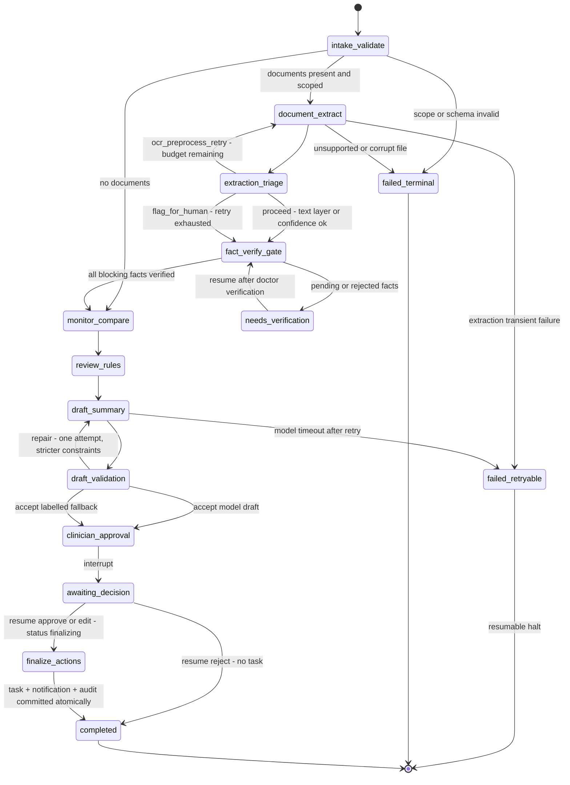

# Shared State and Graph Contract (LangGraph)

| Field | Value |
|---|---|
| Document ID | `CTR-STATE-001` |
| Version | `0.2.0-p0` |
| Status | **IN REVIEW — proposal, not implemented** |
| Phase | `P0` (design). Implementation: P5 |
| Related | `REQ-GRAPH-01..05`, `REQ-LLM-02`, `REQ-RULE-03`, `REQ-DATA-04`, `REQ-OPS-04`, ADR-0006 |
| Revision | 0.2.0 adds `VerificationIssue` vs `ReviewFlag` separation (`P0-R03`), trust level and injected as-of clock (`P0-R05`, `P0-R07`), deterministic task identity and atomic finalize (`P0-R04`), and the bounded extraction/drafting decision loops documented in ADR-0006 |
| Runtime assumption | Python 3.12 on the owner's laptop; LangGraph + `langgraph-checkpoint-sqlite` (versions unverified — see `DEPENDENCIES.md`) |

> This is a **contract proposal**. Nothing here is executed in P0. API details of LangGraph
> (`interrupt`, `Command(resume=...)`, checkpointer construction) must be re-verified against the
> official docs at P5 before implementation.

---

## 1. Scope

One graph, one workflow version, one run per follow-up request:

- run identity and idempotency,
- the typed shared state (Pydantic v2 models, JSON-serializable),
- per-node read/write permissions and tool allowlists,
- nodes, conditional edges, halt paths,
- checkpoint, interrupt/resume, retry and duplicate-suppression policy,
- validation and size limits.

Out of scope: prompt text, SQL schema (see `DATA_DICTIONARY.md`), HTTP shapes (see `API_CONTRACT.md`).

## 2. Run identity and versioning

| Concept | Definition | Example |
|---|---|---|
| `run_id` | UUIDv4 created when an authenticated doctor starts a workflow | `6f1c…` |
| `thread_id` | Checkpoint thread key; equals `run_id` (one thread per run, no reuse) | `6f1c…` |
| `workflow_version` | SemVer of the graph shape + node semantics | `1.0.0` |
| `state_schema_version` | SemVer of this state contract | `1.0.0` |
| `policy_version` | Version of the demo rule policy file | `demo-policy-1.1.0` |
| `as_of_utc` | Injected evaluation clock: policy value in demo mode, real instant otherwise; persisted on the run | `2026-11-14T12:00:00Z` |
| `prompt_version` | Version tag of the draft prompt/template | `draft-v1` |
| `idempotency_key` | Server-computed SHA-256 over stable inputs (§7) | hex digest |

Rules:

1. A run never changes `workflow_version` mid-flight. A version bump invalidates old in-flight runs at resume time with `E_WORKFLOW_VERSION_MISMATCH`.
2. A checkpoint with an unknown `state_schema_version` cannot be resumed; the run is marked `failed_terminal` and audited.
3. `workflow_version`, `policy_version`, `prompt_version` and model metadata are persisted on every draft/review record so that any output can be explained later.

## 3. Shared state (Pydantic v2 proposal)

All models are `extra="forbid"`, all collections are bounded by the caps in §8, and the whole state must round-trip through JSON (no ORM objects, file handles, bytes, or datetime objects without ISO-8601 serialization).

```python
# backend/app/agents/state.py  (PROPOSAL ONLY — not created in P0)
from __future__ import annotations

from datetime import datetime
from enum import StrEnum
from typing import Annotated, Literal

from pydantic import BaseModel, ConfigDict, Field, StringConstraints

SemVer = Annotated[str, StringConstraints(pattern=r"^\d+\.\d+\.\d+$")]
Uuid = Annotated[str, StringConstraints(pattern=r"^[0-9a-fA-F-]{36}$")]
Sha256 = Annotated[str, StringConstraints(pattern=r"^[0-9a-f]{64}$")]
Iso = Annotated[str, StringConstraints(pattern=r"^\d{4}-\d{2}-\d{2}T\d{2}:\d{2}:\d{2}Z$")]


class Strict(BaseModel):
    model_config = ConfigDict(extra="forbid", frozen=False)


class RunStatus(StrEnum):
    queued = "queued"
    running = "running"
    needs_verification = "needs_verification"   # halted, resumable
    awaiting_decision = "awaiting_decision"     # interrupted, resumable
    finalizing = "finalizing"
    completed = "completed"
    failed_retryable = "failed_retryable"       # halted, resumable
    failed_terminal = "failed_terminal"


class ProvenanceRef(Strict):
    kind: Literal["document_span", "observation", "checkin_note"]
    document_id: Uuid | None = None
    page_index: int | None = Field(default=None, ge=0, le=200)
    char_start: int | None = Field(default=None, ge=0)
    char_end: int | None = Field(default=None, ge=0)
    observation_id: Uuid | None = None
    raw_text: str | None = Field(default=None, max_length=500)
    extractor: Literal["pypdf", "tesseract", "manual", "patient_form"] | None = None


class QualityFlag(StrEnum):
    clean = "clean"
    low_confidence = "low_confidence"
    ambiguous_date = "ambiguous_date"
    ambiguous_unit = "ambiguous_unit"
    unparseable_value = "unparseable_value"
    source_conflict = "source_conflict"
    page_missing = "page_missing"


class VerificationStatus(StrEnum):
    pending = "pending"
    verified = "verified"
    rejected = "rejected"


class ExtractedFact(Strict):
    fact_id: Uuid
    patient_id: Uuid
    document_id: Uuid
    field_name: Literal["report_date", "test_name", "value", "unit", "reference_text"]
    raw_text: str = Field(max_length=300)
    normalized_value: str | None = Field(default=None, max_length=120)
    unit: str | None = Field(default=None, max_length=32)
    quality_flags: list[QualityFlag] = Field(default_factory=list, max_length=6)
    verification_status: VerificationStatus = VerificationStatus.pending
    provenance: ProvenanceRef
    verified_by: Uuid | None = None
    verified_at: Iso | None = None
    verification_note: str | None = Field(default=None, max_length=300)


class VerifiedFact(Strict):
    """A fact a human accepted or corrected. The only fact type admissible downstream."""
    fact_id: Uuid
    patient_id: Uuid
    field_name: str
    value: str
    unit: str | None = None
    measured_at: Iso | None = None
    evidence: list[ProvenanceRef] = Field(min_length=1, max_length=4)
    verified_by: Uuid
    verified_at: Iso


class TrustLevel(StrEnum):
    self_reported_validated = "self_reported_validated"   # patient check-in; schema/unit/plausibility checked
    doctor_verified = "doctor_verified"                   # derived from a doctor-verified fact or a correction


class ObservationView(Strict):
    observation_id: Uuid
    patient_id: Uuid
    measure_type: Literal["systolic_bp", "diastolic_bp", "heart_rate", "glucose"]
    value: float
    unit: Literal["mmHg", "bpm", "mg/dL"]
    measured_at: Iso
    source: Literal["patient_checkin", "verified_document", "seed_fixture"]
    validation: Literal["ok", "ok_with_warning", "rejected"]   # schema/units/plausibility data check
    trust_level: TrustLevel                                    # provenance class, never conflated
    verified_by: Uuid | None = None                            # required iff doctor_verified
    verified_at: Iso | None = None
    evidence: list[ProvenanceRef] = Field(default_factory=list, max_length=4)


class ComparisonResult(Strict):
    comparison_id: Uuid
    measure_type: str
    unit: str
    current_observation_id: Uuid
    baseline_observation_id: Uuid | None = None
    current_value: float
    baseline_value: float | None = None
    delta: float | None = None
    comparable: bool
    incomparable_reason: Literal["no_baseline", "unit_mismatch", "stale_baseline", "missing_timestamp"] | None = None
    trust_basis: Literal["self_reported", "doctor_verified", "mixed"]
    evidence: list[ProvenanceRef] = Field(default_factory=list, max_length=4)


class VerificationIssue(Strict):
    """Pre-verification blocker emitted by the gate. Never a review rule, never trusted downstream."""
    issue_id: Uuid
    issue_type: Literal["VI-001", "VI-002", "VI-003", "VI-004", "VI-005", "VI-006"]
    reason_code: str = Field(max_length=64)
    blocking: Literal[True] = True
    message: str = Field(max_length=240)          # neutral wording, no clinical interpretation
    document_id: Uuid | None = None
    fact_ids: list[Uuid] = Field(default_factory=list, max_length=8)
    evidence: list[ProvenanceRef] = Field(min_length=1, max_length=8)
    created_at: Iso


class ReviewFlag(Strict):
    """Post-verification deterministic review prompt; inputs are verified evidence only."""
    review_item_id: Uuid
    rule_id: str = Field(pattern=r"^DR-\d{3}$")
    reason_code: str = Field(max_length=64)
    workflow_hint: Literal["data_quality", "verification_needed", "change_to_review"] | None = None
    message: str = Field(max_length=240)          # neutral wording, no clinical interpretation
    trust_basis: Literal["self_reported", "doctor_verified", "mixed"]
    evidence: list[ProvenanceRef] = Field(min_length=1, max_length=8)
    fact_ids: list[Uuid] = Field(default_factory=list, max_length=8)
    observation_ids: list[Uuid] = Field(default_factory=list, max_length=8)
    policy_version: str
    demo_only: Literal[True] = True
    dedupe_key: Sha256
    state: Literal["open", "decided"] = "open"


class ClaimCitation(Strict):
    text: str = Field(max_length=400)
    evidence: list[ProvenanceRef] = Field(min_length=1, max_length=6)


class DraftSummary(Strict):
    draft_id: Uuid
    provider: Literal["ollama", "deterministic_fallback"]
    model: str | None = None                      # null for fallback; never invented
    execution_status: Literal["model_ok", "model_invalid_schema", "model_timeout", "model_unavailable", "fallback_no_model"]
    prompt_version: str
    latency_ms: int | None = Field(default=None, ge=0)
    claims: list[ClaimCitation] = Field(default_factory=list, max_length=20)
    uncertainties: list[str] = Field(default_factory=list, max_length=10)
    not_asserted: list[str] = Field(default_factory=list, max_length=10)
    disclaimer: Literal["EDUCATIONAL / SYNTHETIC DATA / NOT FOR CLINICAL USE"]
    created_at: Iso


class ApprovalDecision(Strict):
    decision_id: Uuid | None = None
    decision: Literal["approve", "edit", "reject"] | None = None
    edited_summary: str | None = Field(default=None, max_length=4000)
    reason: str | None = Field(default=None, max_length=500)
    doctor_id: Uuid | None = None
    decided_at: Iso | None = None


class TaskDraft(Strict):
    action_key: Sha256                             # derived from the persisted decision, never from task_id
    task_id: Uuid                                  # uuid5(namespace, action_key): stable across retries
    title: str = Field(max_length=160)
    due_date: str | None = Field(default=None, pattern=r"^\d{4}-\d{2}-\d{2}$")
    note: str | None = Field(default=None, max_length=500)
    notification_text: str | None = Field(default=None, max_length=240)


class AgentError(Strict):
    code: str = Field(max_length=48)              # e.g. E_EXTRACTION_FAILED, E_MODEL_TIMEOUT
    node: str = Field(max_length=48)
    message: str = Field(max_length=300)          # no document body, no secrets
    retryable: bool
    attempt: int = Field(ge=1, le=5)
    occurred_at: Iso


class NodeEvent(Strict):
    node: str
    started_at: Iso
    ended_at: Iso | None = None
    outcome: Literal["ok", "halted", "interrupted", "retried", "failed"] | None = None
    tools_called: list[str] = Field(default_factory=list, max_length=6)


class SharedGraphState(Strict):
    # identity
    run_id: Uuid
    thread_id: Uuid
    workflow_version: SemVer
    state_schema_version: SemVer
    policy_version: str
    prompt_version: str
    as_of_utc: Iso
    idempotency_key: Sha256
    started_at: Iso

    # scope (set from the authenticated request, never from client-supplied facts)
    patient_id: Uuid
    doctor_id: Uuid
    encounter_id: Uuid | None = None
    document_ids: list[Uuid] = Field(default_factory=list, max_length=5)
    observation_ids: list[Uuid] = Field(default_factory=list, max_length=20)

    # evidence
    extraction_facts: list[ExtractedFact] = Field(default_factory=list, max_length=40)
    verified_facts: list[VerifiedFact] = Field(default_factory=list, max_length=20)
    observations: list[ObservationView] = Field(default_factory=list, max_length=20)
    comparisons: list[ComparisonResult] = Field(default_factory=list, max_length=20)

    # agent outputs
    verification_issues: list[VerificationIssue] = Field(default_factory=list, max_length=20)
    review_flags: list[ReviewFlag] = Field(default_factory=list, max_length=20)
    draft_summary: DraftSummary | None = None
    approval: ApprovalDecision = Field(default_factory=ApprovalDecision)
    pending_tasks: list[TaskDraft] = Field(default_factory=list, max_length=5)
    created_task_ids: list[Uuid] = Field(default_factory=list, max_length=5)

    # control
    status: RunStatus = RunStatus.queued
    current_node: str | None = None
    halt_reason: Literal["unverified_facts", "model_failed", "retry_exhausted", "needs_human_decision"] | None = None
    retry_counts: dict[str, int] = Field(default_factory=dict)   # node -> attempts, capped in §8
    errors: list[AgentError] = Field(default_factory=list, max_length=10)
    events: list[NodeEvent] = Field(default_factory=list, max_length=40)
    model_metadata: dict[str, str] = Field(default_factory=dict) # provider/model/latency summary only
    updated_at: Iso
```

Design notes:

- **No ORM objects** in state: nodes receive IDs and receive facts through tool calls returning typed DTOs.
- **Verified-only gate** is enforced structurally: downstream nodes may only read `VerifiedFact` and `ObservationView`, never `ExtractedFact` (`REQ-SEC-04`).
- `message` on `ReviewFlag` and `VerificationIssue` is restricted to neutral, non-clinical wording; see `docs/clinical-safety/DEMO_REVIEW_RULES.md` §6.
- `disclaimer` is a fixed literal, so a draft cannot exist without the educational label (`REQ-SEC-05`).
- **Two distinct outputs.** `verification_issues` (pre-verification blockers, `VI-*`) and `review_flags`
  (post-verification prompts, `DR-*`) are separate state fields produced by separate nodes. A `VI-*` item can
  never be promoted into a `DR-*` flag, and neither is derived from the other (`P0-R03`).
- **Trust is explicit.** Every observation carries `trust_level`; `self_reported_validated` values are never
  described as doctor-verified, and `verified_by` is null for them (`REQ-DATA-04`).
- **Clock is injected.** `as_of_utc` is set once per run and used by every time-dependent rule, so the same
  run replays identically on any date (`REQ-OPS-04`).

## 4. Nodes, reads/writes, and transitions

### 4.1 Node table

| # | Node (agent) | Reads | Writes | Tools (allowlist) | May interrupt? |
|---|---|---|---|---|---|
| N0 | `intake_validate` (orchestrator) | run request, scope | `observations`, `document_ids`, `status` | none — service-layer reads only | no |
| N1 | `document_extract` (`medical_document`) | `document_ids` | `extraction_facts` | `extract_document`, `get_document_pages`, `validate_structured_fields` | no |
| N1a | `extraction_triage` (orchestrator, deterministic router) | `extraction_facts`, extraction attempts + confidence | `events` (`path_selected`, `path_reason`), `retry_counts` | none — reads attempt metadata | no |
| N2 | `fact_verify_gate` (orchestrator, deterministic) | `extraction_facts`, document↔patient reference | `verification_issues`, `status`, `halt_reason` | none — service-layer reads only | **yes** (halt `needs_verification`) |
| N3 | `monitor_compare` (`patient_monitoring`) | `verified_facts`, `observations` | `comparisons` | `read_observations`, `compare_observations` | no |
| N4 | `review_rules` (`review_priority`) | `verified_facts`, `comparisons` | `review_flags` | `read_verified_facts`, `evaluate_demo_review_rules` | no |
| N5 | `draft_summary` (`doctor_communication`) | `verified_facts`, `comparisons`, `review_flags` | `draft_summary`, `model_metadata` | `read_verified_facts`, `draft_grounded_summary` | no |
| N5a | `draft_validation` (orchestrator, deterministic) | `draft_summary` | `events` (`validation_outcome`), `retry_counts` | none — schema/citation/content validator | no |
| N6 | `clinician_approval` (orchestrator) | `draft_summary`, `review_flags` | `approval`, `status` | none — service-layer reads only | **yes** (interrupt `awaiting_decision`) |
| N7 | `finalize_actions` (`follow_up`) | `approval` (must be approved/edited) | `pending_tasks`, `created_task_ids`, `status` | `create_in_app_task`, `list_due_tasks` | no |
| N8 | `halted` (orchestrator) | any | `status`, `halt_reason` | none | terminal-for-now, resumable |

### 4.2 Transition graph



Routing rules:

1. Conditional edge decisions are **deterministic functions of state**, never model output (`REQ-GRAPH-01`).
2. `extraction_triage` is the bounded tool-selection step described in ADR-0006 §4: it chooses
   `proceed` / `ocr_preprocess_retry` / `flag_for_human` from typed evidence (text-layer coverage,
   OCR confidence, attempt count) and records `path_selected` + `path_reason` in the trace. Retry budget is 2;
   the router cannot loop, and it cannot skip verification.
3. `fact_verify_gate` blocks the pipeline when any fact that a downstream node would consume is `pending` or
   `rejected`. It emits `VerificationIssue` items (`VI-*`) — never `ReviewFlag`s — and halts with
   `needs_verification`. Non-blocking informational facts may remain pending only if no downstream node reads them.
4. `draft_summary` may proceed on fallback (labelled); it may **not** proceed if it would fabricate to fill a gap.
   `draft_validation` accepts, requests one bounded repair, or rejects to the fallback path (ADR-0006 §4.2).
5. `finalize_actions` is unreachable unless `approval.decision in {approve, edit}` **and**
   `approval.doctor_id` matches an authenticated doctor with patient scope. `reject` routes straight to
   `completed` with no task (`US-10`).
6. `finalize_actions` runs only while the run is `finalizing` (entered when a paused `awaiting_decision` run is
   resumed with a persisted approve/edit decision), and commits task + notification + audit finalization in **one**
   transaction (§7.2).
7. Every node appends exactly one `NodeEvent` on entry/exit; the trace is part of the demo evidence.

## 5. Checkpoint, interrupt and resume

### 5.1 Checkpoint policy

- Checkpointer: `langgraph-checkpoint-sqlite` on a dedicated SQLite file (ADR-0003).
- A checkpoint is written **after** each node completes and **before** each interrupt is surfaced.
- `thread_id == run_id`; one thread per run, never reused across patients.
- Sync is not forced on every node, but the approval interrupt explicitly flushes so a hard kill preserves `awaiting_decision`.
- Retention: checkpoints are runtime artifacts. Reset (`POST /api/v1/demo/reset`) deletes app DB + checkpoint DB + uploads together.

### 5.2 Interrupt contract

| Property | Rule |
|---|---|
| Where | Only N2 (`needs_verification`) and N6 (`awaiting_decision`) |
| Payload surfaced to UI | run ID, status, `as_of_utc`, draft + citations, `verification_issues[]` (pre-verification) or `review_flags[]` (post-verification), blocking fact IDs, provider metadata, allowed actions |
| Resume input | `{run_id, decision, doctor_id (from session, never body), reason?, edited_summary?}` |
| Resume validation | run status must be the expected paused state; doctor must be authenticated and patient-scoped; `decision` must be in the allowed set; `edited_summary` capped at 4000 chars |
| Resume after verification | blocked fact IDs must now be `verified`; otherwise re-interrupt with the same reason and increment no side effects |
| Idempotent resume | Resuming a run already `completed` returns the stored result with `200` and no new task (no `409` loop) |
| Crash mid-resume | Node is not checkpointed as complete until its writes commit; resume recomputes deterministically and the unique idempotency index suppresses duplicates |

### 5.3 What the agent may never do on resume

- Accept client-supplied clinical facts, observation values, or evidence as authoritative.
- Skip verification because a request says `force=true`.
- Create a task because a request says `approved=true` without a matching approval record.
- Change `workflow_version`, `policy_version`, patient scope, or `doctor_id`.

## 6. Retry and failure policy

| Failure class | Examples | Behaviour | Max attempts |
|---|---|---|---|
| Validation / authorization | bad schema, out-of-scope patient, unsupported file type | Terminal immediately, typed error, no retry | 1 |
| Document parse permanent | corrupt PDF, encrypted PDF, zero extractable pages | Terminal for that document; run halts with `failed_terminal` only if the document was required | 1 |
| OCR transient | Tesseract process error, timeout on a large page | Retry with image downscale once, then flag `page_missing`/low confidence | 2 |
| OCR low confidence | Engine confidence below `ocr_confidence_floor` | `extraction_triage` selects `ocr_preprocess_retry` (deterministic preprocessing), then `flag_for_human` with `VI-005` | 2 |
| Draft schema/citation failure | invalid JSON, unsupported evidence ID, prohibited content | `draft_validation` requests one repair with stricter constraints, then labelled fallback | 2 |
| Model transport | connection refused, socket timeout | Retry once with reduced output budget, then fallback | 2 |
| Model output invalid | JSON schema violation, unsupported claim citation | One repair attempt with a stricter instruction; then fallback | 2 |
| Database busy | `database is locked` | Bounded backoff (e.g. 50/150/400 ms) | 3 |
| Unknown exception | bug | No retry, `failed_terminal`, audit with stack-class summary only (no data) | 1 |

Rules:

- Retries are **per node**, counted in `retry_counts`, and never re-run earlier successful nodes.
- A retried node must be a pure function of state plus external reads; a mutating tool must be idempotent by key.
- No unbounded loops: `retry_counts[node]` capped at 5; exceeding it forces `failed_retryable` with `halt_reason=retry_exhausted`.
- Backoff uses the configured demo values; no jitter claim is made in P0.

## 7. Idempotency

| Operation | Idempotency key | Storage guard |
|---|---|---|
| Start a workflow run | `sha256(patient_id | workflow_version | sorted(document_ids) | sorted(observation_ids) | client_request_id)` | Unique index on `workflow_run.idempotency_key`; repeat returns the existing run |
| Verification decision | `sha256(fact_id | decision | normalized_value | doctor_id)` | Append-only; identical repeat is a no-op, conflicting repeat is rejected |
| Approval decision | `sha256(run_id | decision | doctor_id | sha256(edited_summary or ""))` | Unique per run; a second different decision is `409 E_APPROVAL_CONFLICT` |
| Task creation | `action_key = sha256(workflow_version | patient_id | approval_decision_id | "followup_task" | "slot:1")`; `task_id = uuid5(TASK_NAMESPACE, action_key)` (derived, never regenerated); row key = `action_key` | Unique index on `follow_up_task.idempotency_key`; duplicate insert is a no-op and the stored row is returned |
| Notification | `sha256(approval_decision_id | "notification")`; id = `uuid5(TASK_NAMESPACE, key + ":notification")` | Unique index; one notification per decision |
| Audit event | `sha256(run_id | node | event_type | sequence)` | Unique index; replay cannot duplicate audit rows |

**Why the task key no longer contains `task_id` (resolves `P0-R04`).** A generated ID is not stable across a
retry, so including it allowed a second row. The key is now derived **only** from immutable, already-persisted
values: the workflow version, the patient, and the approval decision ID, plus a fixed task slot. The task UUID
is then derived from that key, so a replay computes the identical row identity. `TaskDraft.action_key` and
`TaskDraft.task_id` are both required (non-optional) fields.

### 7.1 Decision → finalize state sequence

```text
awaiting_decision --resume(approve|edit)--> finalizing --commit--> completed
awaiting_decision --resume(reject)-------> completed            (no task, no notification)
```

`create_in_app_task`'s precondition is therefore **`status == finalizing`** (not `awaiting_decision`), which is
only reachable after the approval decision has been persisted. A tool call attempted in any other state returns
`E_APPROVAL_REQUIRED` or `E_RUN_NOT_PAUSED`.

### 7.2 Atomic finalize and crash recovery

1. One SQLite transaction writes: approval decision row, follow-up task, in-app notification, audit finalization
   event, and the run status transition `finalizing → completed`.
2. Unique indexes (`approval_decision.workflow_run_id`, `follow_up_task.idempotency_key`,
   `in_app_notification.idempotency_key`, `audit_event.idempotency_key`) make a replayed transaction a no-op
   rather than a duplicate.
3. Crash **before** commit: no rows exist, the checkpoint still says `awaiting_decision`, and resume recomputes
   the same `action_key`/`task_id` — exactly one task.
4. Crash **after** commit but before the HTTP response: the run reads `completed`; a repeated decision returns
   the stored result with `200` and no new row.
5. A decision that conflicts with the stored one returns `409 E_APPROVAL_CONFLICT` and writes nothing.

Guarantees to test (`REQ-GRAPH-04`, P7):

1. Double-clicking "Approve" produces one approval record and one task.
2. Killing the API after task commit but before the response, then resuming, produces no second task — even
   when the process regenerates in-memory objects, because the task identity is derived from the stored decision.
3. Replaying the same `POST /workflows/follow-up` with the same body and `Idempotency-Key` returns the same `run_id`.
4. Rejection can never create a task (no key exists for it).

## 8. Validation, bounds and defensive limits

| Bound | Value (demo default) | Rationale |
|---|---|---|
| `document_ids` per run | 5 | Small demo scope |
| `observation_ids` per run | 20 | Prevents unbounded state |
| `extraction_facts` | 40 | 5 declared fields × pages ceiling |
| `verified_facts` | 20 | Downstream usability |
| `review_flags` | 20 | De-duplicated |
| `claims` in a draft | 20 | Bounded output |
| Free text per field | 300–4000 chars by field | Prompt/size control |
| `retry_counts[node]` | ≤ 5 | Loop prevention |
| `events` | 40 | Trace size |
| Upload size / page count | set in `API_CONTRACT.md` | Resource protection |

Additional invariants:

1. `patient_id` and `doctor_id` in state must equal the authenticated request identity; a mismatch is `E_SCOPE_VIOLATION` (`REQ-SEC-01`).
2. `verified_facts[].verified_by` must be a doctor identity; `ACT-SYS` cannot supply it.
3. Every `VerifiedFact` has ≥ 1 evidence reference (`REQ-VERIFY-01`).
4. `ReviewFlag.dedupe_key = sha256(patient_id | rule_id | sorted(evidence keys) | trust_basis)`; duplicates collapse.
5. State is rejected (not repaired) if it violates the schema; recovery is resume from the last valid checkpoint, never a best-effort cast.
6. `verification_issues` may contain only `VI-001..VI-006`; `review_flags` may contain only `DR-001/003/005/006/008/009`.
   The retired IDs `DR-002/004/007/010` are schema-invalid (`P0-R03`).
7. Every `ObservationView` has a `trust_level`; `doctor_verified` requires `verified_by` + `verified_at`, and
   `self_reported_validated` must have both null (`REQ-DATA-04`).
8. `as_of_utc` is immutable for the lifetime of a run and is the only clock used by `DR-001`/`DR-003` (`REQ-OPS-04`).
9. `TaskDraft.action_key` and `TaskDraft.task_id` are required and must satisfy
   `task_id == uuid5(TASK_NAMESPACE, action_key)` (`P0-R04`).

## 9. Traceability of this contract

| Contract section | Requirement | Planned verification |
|---|---|---|
| State models, caps | `REQ-GRAPH-01` | Schema unit tests (P5) |
| Verified-only gate | `REQ-SEC-04` | Negative integration test: pending fact in draft → rejected (P5) |
| Interrupt/resume | `REQ-GRAPH-02/03` | Restart-mid-approval test with one task only (P7) |
| Retry policy | `REQ-GRAPH-04` | Simulated timeout/DB-busy tests (P5/P7) |
| Idempotency | `REQ-GRAPH-04`, `REQ-TASK-01` | Duplicate-request and double-approve tests (P7) |
| Trace events | `REQ-AUDIT-01` | Run timeline assertions (P6/P7) |
| Trust levels on observations | `REQ-DATA-04` | `TRUST-01`, `NEG-19` (P4/P7) |
| Injected as-of clock | `REQ-OPS-04` | `RULE-08` (P4) |
| Bounded path selection (`extraction_triage`, `draft_validation`) | `REQ-GRAPH-01`, ADR-0006 | `AD-01` (P5, demonstrated P8) |

## 10. Bounded decision-making (agentic depth)

The graph contains two genuine, observable decision loops that are **not** simple function chaining:
`extraction_triage` (chooses a tool path and retries preprocessing, bounded at 2) and `draft_validation`
(accepts, repairs once, or falls back). Both are deterministic routers over typed evidence, both record their
choice in the trace, and neither can bypass verification or approval. ADR-0006 §4–§6 defines the semantics,
the trade-off, and the acceptance test `AD-01`; the demo shows one selection (`DEMO_SCENARIOS.md` step C2a).

## 11. Explicit non-goals of this contract

- No autonomous re-planning, self-critique loops, or agent-created subgraphs.
- No free-roaming multi-LLM conversation, and no self-modifying tool allowlist.
- No model-controlled routing: every edge predicate is a deterministic function of typed state.
- No cross-run memory, no long-term semantic memory, no vector store.
- No multi-user concurrency guarantees.
- No clinical prioritization: `workflow_hint` is ordering metadata, not severity.
- No silent recovery that drops evidence to "make it work".
