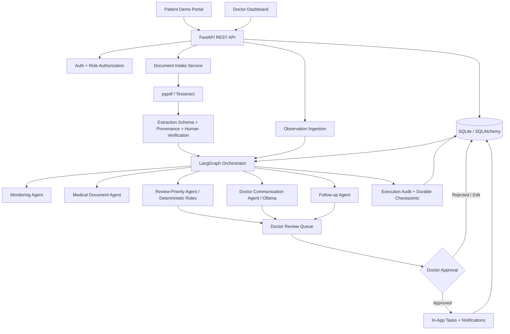

# AI Doctor Follow-Up — Master Implementation Plan

> **Project:** Multi-Agent Clinical Workflow Assistant (DEPI Graduation Project)  
> **Repository name (proposed):** `AI-Doctor-FollowUp-Agent`  
> **Plan baseline:** v0.2 / 2026-11-14 (historical scope/specification). **Execution status refreshed 2026-11-18**, pending documentation-PR review; see `PHASE_PROGRESS.md` for latest accepted/blocked phase states. P0/P1/P2 were owner-approved and merged on 2026-11-14.  
> **Target:** Fully local, zero-paid-API, end-to-end educational demonstration  
> **Source of truth:** This file, plus `PHASE_PROGRESS.md`, architecture ADRs, PR evidence, and tests  
> **Working language:** English for implementation contracts; Arabic/English explanation in discussion

## Live execution status (2026-11-18; proposed tracking update)

The numbered plan below remains the **scope baseline**, not a claim that its old setup instructions are current. The authoritative phase register is [PHASE_PROGRESS.md](PHASE_PROGRESS.md); details are in `docs/phase-reports` and owner PR decisions. This section is a concise **status index**, not phase acceptance.

| Phase | Deliverable category | Execution status | Completion / next gate |
|---|---|---|---|
| P0 | Governance and binding contracts | **PASS — owner-approved and merged** | [PR #2](https://github.com/Muhammed-Fathi/AI-Doctor-FollowUp-Agent/pull/2) / `4422566` |
| P1 | Foundation, reproducible Windows startup | **PASS — owner-approved and merged** | [PR #4](https://github.com/Muhammed-Fathi/AI-Doctor-FollowUp-Agent/pull/4) / `2c85db4` |
| P2 | Synthetic patient domain, role permissions, check-ins | **PASS — owner-approved and merged** | [PR #7](https://github.com/Muhammed-Fathi/AI-Doctor-FollowUp-Agent/pull/7) / `777f661` |
| P3 | Document ingestion, OCR, provenance, doctor verification | **IN_REVIEW — CANONICAL ARTIFACT AUDIT PENDING** | v1.1.3 owner Windows `plan_only` and `probe_only` PASS. After a `DeprecationWarning` interrupted the outer canonical wrapper log, **read-only inspection** found 4 existing canonical evidence files and 3 JSONL records; summary reports `exit=0`, `COMPLETE=True`, protected postflight PASS. [Incident + evidence follow-up](../phase-reports/P3_E1_E3_V113_CANONICAL_WRAPPER_INCIDENT.md). Full records/metrics still need independent review. **No OCR fidelity PASS or next mode authorized.** `GOLD-EX-11=FAIL / NOT PROVEN`. |
| P4 | Monitoring and deterministic demo review rules | **TODO — NOT STARTED** | Blocked on P3 owner acceptance / merge |
| P5 | LangGraph bounded agents, Ollama drafting, approval | **TODO — NOT STARTED** | No early implementation permitted |
| P6 | Doctor/patient UI, in-app task surfaces | **TODO — NOT STARTED** | No early implementation permitted |
| P7 | Integrated quality, robustness, safety evaluation | **TODO — NOT STARTED** | No early implementation permitted |
| P8 | Local demo and final handoff | **TODO — NOT STARTED** | No early implementation permitted |

**Phase completion procedure (apply after every P0–P8):** Keep a `PHASE_N_REPORT.md` or scoped phase evidence report with exact implementation vs omissions, requirements/tests, Windows/CI evidence (executed vs NOT RUN), safety/limitations, source commits and rollback. Update the **single** `PHASE_PROGRESS.md` row and append a dated evidence/owner-decision entry. Update this high-level status table. A phase becomes **PASS only** after independent review, relevant owner Windows evidence, **explicit owner approval**, and the approved PR merged. No agent may self-approve or edit `main` directly. An in-review phase remains `IN_REVIEW` even if part of its implementation is complete.

**Current P3 gate:** v1.1.3 `plan_only` and `probe_only` both PASSED. A separate `canonical_baseline` attempt produced an outer PowerShell 5.1 `NativeCommandError` from Pillow warning, but read-only inspection of the existing run identified all four expected files, three saved JSONL records and an internal `exit_code=0`, `COMPLETE=True`, postflight PASS. **This is owner-reported completion, NOT an independent fidelity evaluation.** Obtain actual `manifest.json`, `metrics_summary.json`, `records.jsonl`, `records.csv` plus original 1,096-byte outer log for consistency review; do not rerun or advance yet. [Canonical incident/evidence update](../phase-reports/P3_E1_E3_V113_CANONICAL_WRAPPER_INCIDENT.md). No exploratory, holdout, freeze, P3 acceptance/merge or P4/P5 without separate authorization; `GOLD-EX-11` remains FAIL / NOT PROVEN.

---

## 1. Product definition and boundaries

### 1.1 Vision
A doctor-centered follow-up assistant that collects mock patient check-ins and uploaded medical documents, extracts structured observations, compares them with prior records, identifies **items for clinician review**, prepares evidence-linked draft summaries, and organizes doctor-approved follow-up tasks. The doctor—not the AI—makes any clinical decision.

**The system is not** a patient-facing autonomous doctor, diagnostic tool, treatment recommender, medical device, emergency-triage product, or clinically validated application.

### 1.2 Primary users
- **Doctor:** sees patient list, longitudinal timeline, documents, review queue, draft follow-up summaries and approval actions.
- **Patient (minimal demo portal):** enters periodic measurements and uploads a PDF/image; does not receive medical recommendations.
- **Demo administrator:** seeds synthetic data and resets an isolated local demonstration environment.

### 1.3 In-scope MVP (one routine outpatient follow-up workflow)
1. Doctor/patient demo authentication and role-based access.
2. Multiple synthetic patient profiles, encounters and historical measurements.
3. Patient check-in (timestamped BP, heart rate, optional glucose, symptoms / note; fields must have units and source).
4. PDF/image upload (text-based PDF first; OCR fallback for scanned pages and images).
5. Extracted facts with source reference, provenance, quality flags, editable human-confirmation UI; never silently convert ambiguous data into trusted facts.
6. Time-series comparison with baseline and configurable, **demo-only** review triggers. These are workflow rules, **not medical decision thresholds**.
7. LangGraph multi-agent state transitions with persisted execution, tool permissions, review/approval interruption and resumability.
8. Local LLM for schema-constrained, grounded draft summaries; deterministic fallback clearly labeled when the LLM is unavailable.
9. Doctor queue with approve/reject/edit actions and an audit trail.
10. In-app follow-up tasks, due dates and notifications (mock/in-app only; no external SMS/email in MVP).
11. Repeatable seeded end-to-end demonstration and local Windows PowerShell verification.

### 1.4 Explicitly out of scope for graduation MVP
- Real patients, real protected medical records, cloud-hosted sensitive data, production HIPAA/GDPR compliance claims, clinical effectiveness claims.
- Autonomous diagnosis, prescriptions, drug dosing, automatic patient treatment advice, emergency response or automatic clinical escalation without clinician governance.
- Mobile native applications, hospital EHR integration, FHIR import, external messaging services, billing, fine-tuning/training a medical foundation model.
- Voice assistants, fully multilingual medical OCR, advanced RAG/vector database, cloud deployment, and external web-search agent (possible later extensions only).

### 1.5 Non-negotiable safety contract
- Only synthetic, fictitious, explicitly labeled demo data is permitted in the repo/test suite.
- No medical assertion should be fabricated. Every claim in a doctor summary must map to record IDs, document page/spans or typed observations.
- The LLM can **draft prose**, not declare a clinical risk level, set a medically meaningful threshold or perform an external side effect.
- A deterministic, audited review-trigger engine decides whether a **review item** is generated according to an approved DEMO configuration. Triggers are not patient care advice.
- Doctor approval is required before finalizing follow-up communications/tasks intended for any recipient. In MVP, communication stays in-app.
- Ambiguous dates, units, OCR errors, wrong-patient mapping, conflicting entries and missing evidence require correction/review, never an invisible best guess.
- Prompt injection embedded in uploads is untrusted document content; cannot become instructions/tools/access rules.
- Provide a visible `EDUCATIONAL / SYNTHETIC DATA / NOT FOR CLINICAL USE` notice in the UI, generated summaries and demo materials.

## 2. Reference architecture



### 2.1 Intentional separation of responsibility
- **API:** auth, validation, patient/document/task CRUD, workflow launch/status endpoints.
- **Domain services:** factual database reads, extraction, comparison, deterministic rules, policies and audit; can operate without an LLM.
- **Agents:** task-specific nodes with bounded tools and a shared typed graph state; no agent has unrestricted database access or arbitrary code execution.
- **Orchestrator:** routes tasks and approvals with explicit transitions; no uncontrolled agent-to-agent chatting.
- **Local LLM adapter:** injected provider with `OllamaProvider` and `DeterministicFallbackProvider`; all outputs carry `provider`, `model`, `prompt_version`, and `execution_status`.
- **Doctor UI:** sees evidence, uncertainties, pending approvals and workflow history.

### 2.2 Five proposed agents aligned to the assignment
| Agent | Input | Authorized tools | Output | Explicit prohibition |
|---|---|---|---|---|
| Medical Document Agent | PDF/image/extracted text and patient mapping | `extract_document`, `get_document_pages`, `validate_structured_fields` | Structured facts + provenance + flags | Cannot trust ambiguous OCR without verification |
| Patient Monitoring Agent | Timestamped observations and prior baseline | `read_observations`, `compare_observations` | Differences, trends, missing-data flags | Cannot diagnose |
| Review-Priority Agent (replaces autonomous "Risk Agent") | Verified facts, comparisons, DEMO policy | `evaluate_demo_review_rules` | Rule IDs, evidence and review queue items | Cannot invent clinical thresholds or make emergency claims |
| Doctor Communication Agent | Verified extracted facts, comparison and review flags | `draft_grounded_summary` via Ollama or template | Doctor-facing draft + structured citations | Cannot approve or send messages |
| Follow-up Agent | Doctor-approved decisions, due dates | `create_in_app_task`, `list_due_tasks` | Reminder/task records | Cannot contact patient externally or modify medical plan on its own |

**Shared LangGraph state** should include `run_id`, `patient_id`, `document_ids`, `observation_ids`, `verified_facts`, `review_flags`, `draft_summary`, `approval_status`, `pending_tasks`, `errors`, `provenance`, `model_metadata`, `timestamps`, and `idempotency_key`. Use strict typed state and stable workflow versions.

**Normative contracts (P0):** the typed state, node read/write permissions, transition edges, checkpoint/interrupt/resume and retry/idempotency policy are specified in `docs/contracts/STATE_AND_GRAPH_CONTRACT.md`; tool allowlists in `docs/contracts/TOOL_CONTRACTS.md`. The five components run inside one graph and only the drafting node uses a model (`ADR-0006`, `ADR-0004`).

### 2.3 Data model minimum
`User`, `Patient`, `Encounter`, `Document`, `ExtractedFact`, `Observation`, `ReviewItem`, `SummaryDraft`, `ApprovalDecision`, `FollowUpTask`, `InAppNotification`, `WorkflowRun`, `AuditEvent`. Use UUIDs or stable IDs; UTC timestamps, displayed time zone, owner/doctor assignment, source, units and created/updated metadata. Keep synthetic fixture sets deterministic.

### 2.4 Example API contract (proposed, finalized in Phase 1/2)
- `GET /health`, `GET /version`, `GET /openapi.json`
- `POST /api/v1/auth/login`, `GET /api/v1/auth/me`
- `GET /api/v1/doctor/patients`, `GET /api/v1/doctor/patients/{id}/timeline`
- `POST /api/v1/patient/check-ins`, `POST /api/v1/documents/upload`
- `GET /api/v1/documents/{id}/extraction`, `POST /api/v1/documents/{id}/verify`
- `POST /api/v1/workflows/follow-up`, `GET /api/v1/workflows/{run_id}`
- `GET /api/v1/doctor/review-items`, `POST /api/v1/doctor/review-items/{id}/decision`
- `GET /api/v1/doctor/tasks`, `POST /api/v1/doctor/tasks/{id}/complete`
- `GET /api/v1/doctor/audit-events` (scoped), `POST /api/v1/demo/reset` (local demo admin only)

No endpoint is binding until an OpenAPI contract and tests are merged. `POST` mutations must be authenticated, validated and idempotent where applicable.

## 3. Free/local technology stack
| Layer | Chosen tool | Rationale / no-cost condition |
|---|---|---|
| Orchestration | Python LangGraph OSS | Explicit state graph, checkpoints, human-in-the-loop |
| Model runtime | Ollama **local API** | No paid inference API; requires a local model and sufficient hardware |
| Model candidates | e.g. `qwen2.5:3b`, `llama3.2:3b` (selection after benchmark) | Small-model candidates, not a performance guarantee; review model-specific terms |
| Backend | FastAPI + Pydantic + SQLAlchemy + Alembic | Typed, testable contracts and persistence |
| DB/checkpoints | SQLite + LangGraph SQLite checkpointer | Sufficient for single-machine educational demo; not production multiuser DB |
| OCR | `pypdf`, `pytesseract`, Tesseract, Pillow + safe PDF page rasterizer | Text-first extraction, OCR if no text; explicit installation/test contract |
| Frontend | React + TypeScript + Vite | Separate roles/views in one local browser app |
| Testing | pytest, httpx, Vitest, Playwright | Unit, API, component and browser E2E |
| Quality | Ruff, type checks, dependency audit, baseline coverage | Free local checks and CI |
| CI | GitHub Actions within included allowance | Keep jobs short; run LLM/GPU tests locally, not hosted CI |
| Notifications | In-app DB records | No SMS, WhatsApp or email expense |
| Hosting | localhost on a Windows laptop | No payment, requires laptop powered on for demo |

**Model strategy:** first benchmark Ollama on the actual Windows machine (CPU and GPU if available), model download and latency. Use schema-constrained outputs (Pydantic JSON schema). A fallback template MUST allow end-to-end smoke tests offline; never pretend the fallback is LLM output. Do not commit model weights or large generated files.

## 4. Repository file layout (target)

```text
AI-Doctor-FollowUp-Agent/
├── README.md
├── AGENTS.md
├── .gitignore
├── .env.example
├── pyproject.toml
├── backend/
│   ├── app/
│   │   ├── main.py
│   │   ├── api/v1/{auth,patients,checkins,documents,workflows,reviews,tasks}.py
│   │   ├── core/{config,security,policies,logging}.py
│   │   ├── db/{base,models,session,migrations}/
│   │   ├── schemas/{patient,document,observation,review,workflow}.py
│   │   ├── services/{intake,extraction,comparisons,review_rules,summary,tasks,audit}.py
│   │   ├── agents/{orchestrator,state,tools,medical_document,monitoring,review_priority,doctor_communication,follow_up}.py
│   │   └── llm/{base,ollama_provider,fallback_provider}.py
│   └── tests/{unit,integration,contracts,safety,e2e}/
├── frontend/
│   ├── package.json
│   ├── src/{app,components,features,pages,services,types}/
│   └── tests/
├── data/
│   ├── synthetic/{patients,observations,reports,golden_cases}/
│   └── runtime/                 # gitignored
├── docs/
│   ├── roadmap/{MASTER_PLAN,PHASE_PROGRESS}.md
│   ├── architecture/{ARCHITECTURE,ADR-0001..ADR-0006}.md
│   ├── contracts/{MVP_SPEC,STATE_AND_GRAPH_CONTRACT,TOOL_CONTRACTS,API_CONTRACT,DATA_DICTIONARY,EXTRACTION_PROVENANCE,LLM_ADAPTER,DEPENDENCIES}.md + openapi.phase0.yaml
│   ├── clinical-safety/{CLINICAL_SAFETY,DEMO_REVIEW_RULES,THREAT_MODEL}.md
│   ├── evaluation/{EVALUATION_MATRIX,GOLD_FIXTURES,TRACEABILITY_MATRIX,LOCAL_BENCHMARK_PLAN}.md
│   ├── demo/DEMO_SCENARIOS.md
│   ├── phase-reports/PHASE_0_REPORT.md
│   └── arena/{ARENA_PHASE_0_PROMPT}.md
├── scripts/
│   ├── powershell/{setup,start,stop,test_all,preflight,demo,reset_demo}.ps1
│   └── python/{seed_demo,verify_evidence}.py
└── .github/workflows/ci.yml
```

The folders above are a **target layout**, not a claim that files already exist. Implement only as each phase requires, with no empty-file padding. Avoid premature microservices, Docker dependency and a vector DB.

## 5. Strict phased delivery roadmap

### Phase 0 — Governance and specification baseline (`P0`)
**Status:** `IN_REVIEW` — documentation-only PR submitted 2026-11-14; owner review and approval pending. This plan alone is not an accepted gate.
**P0 artefacts:** `docs/contracts/{MVP_SPEC,STATE_AND_GRAPH_CONTRACT,TOOL_CONTRACTS,API_CONTRACT,DATA_DICTIONARY,EXTRACTION_PROVENANCE,LLM_ADAPTER,DEPENDENCIES}.md`, `docs/contracts/openapi.phase0.yaml`, `docs/architecture/{ARCHITECTURE,ADR-0001..0006}.md`, `docs/clinical-safety/{CLINICAL_SAFETY,DEMO_REVIEW_RULES,THREAT_MODEL}.md`, `docs/evaluation/{EVALUATION_MATRIX,GOLD_FIXTURES,TRACEABILITY_MATRIX,LOCAL_BENCHMARK_PLAN}.md`, `docs/demo/DEMO_SCENARIOS.md`, `AGENTS.md`, `docs/phase-reports/PHASE_0_REPORT.md`.
- Finalize MVP/non-goals, actors and 3 demo scenarios.
- Document architecture, ADR-0001, data dictionary, doctor/patient permission matrix, clinical safety boundaries, source/citation contract, agent tool allowlist.
- Define demo-only trigger policy and gold synthetic fixtures spec; include threat model, assumed laptop constraints and evaluation plan.
- Create `AGENTS.md`, `docs/roadmap/PHASE_PROGRESS.md`, Phase 0 report, and project README.
- Record exact package/license verification; do not pin unverified latest versions.
- **Exit gate:** document internal consistency, no forbidden autonomy, traceability (requirement → owner/component → acceptance test), an executable P1 plan; docs-only PR reviewed and merged by owner.

### Phase 1 — Foundation and reproducible startup (`P1`)
**Status:** `TODO`; depends on P0 accepted.
- Monorepo skeleton, Python 3.12 venv, Node compatible with installed Vite, dependency lockfiles, `.env.example` and strict `.gitignore`.
- FastAPI `/health` and `/version`; Vite frontend health view; DB initialization and Alembic baseline.
- Implement Windows `preflight.ps1`, `setup.ps1`, `start.ps1`, `stop.ps1`, `test_all.ps1`; verify clean checkout setup.
- Basic schema, backend tests, frontend tests, Ruff checks, GitHub Actions minimal green pipeline.
- **Exit gate:** fresh machine clean-install documentation, `/health` HTTP 200, frontend loads, migrations succeed, tests+CI pass, no secrets or private data in repo.

### Phase 2 — Patient data domain and role-scoped API (`P2`)
**Status:** `TODO`; depends on P1 accepted.
- Implement users/role permissions, doctor-patient assignment, synthetic records, observation schema and historical timeline.
- Local seeded doctor and patient login (no committed production credentials), authorization tests for forbidden cross-patient access.
- Idempotent check-in and timeline APIs; unit validation, missing-field error paths, reproducible demo reset.
- **Exit gate:** patients and doctors have separate authorized read/write abilities; seed/reset reproducible; no wrong-patient leaks; backend contract tests pass.

### Phase 3 — Medical report ingestion and verification (`P3`)
**Status:** `TODO`; depends on P2 accepted.
- PDF text extraction with OCR fallback for scanned PDF/PNG/JPEG; file/type/size/page-count restrictions.
- Extract only a small declared set of report fields (e.g., report date, test name, value, units and page reference), no invented facts.
- Typed extraction outputs and quality warnings; mark unclear values for human correction; doctor verification endpoint and document status.
- Seed clean digital PDF, scanned PDF, corrupted/unsupported file, ambiguous units/date, embedded malicious instructions.
- **Exit gate:** source-backed structured extraction, unsupported formats rejected, manual confirmation path tested, failures never silently trusted.

### Phase 4 — Monitoring and deterministic review rules (`P4`)
**Status:** `TODO`; depends on P3 accepted.
- Compare current verified measurements vs historical baseline; handle repeated values, missing timestamps, changed units, outliers and contradictory inputs.
- Define **synthetic demo policy** (configurable review flags; never medical diagnosis/risk score).
- Generate de-duplicated review items with evidence and rule IDs; maintain reason codes and audit.
- **Exit gate:** gold fixture rules have 100% expected pass/fail outcomes, zero unapproved external side effects, idempotency, cross-patient isolation and documented non-clinical limitation.

### Phase 5 — LangGraph multi-agent engine and draft generation (`P5`)
**Status:** `TODO`; depends on P4 accepted.
- Implement five bounded agent nodes, orchestrator, shared typed state and SQLite checkpoints.
- Add local model abstraction and Ollama schema-constrained draft summarizer; deterministic fallback with transparent provenance.
- Ground each summary fact to database observation or source-page reference; abstain on uncertain/unverified facts.
- Model response validation, timeouts, unavailable-model behavior, repeated execution safety, resumes after pause, tools allowlist; reject document prompt injections.
- Pause before clinician approval with durable `interrupt`/resume semantics; store execution state and audit.
- **Exit gate:** real agent transitions + persisted checkpoint, measured local runtime, clinical reviewer gate enforced, successful resume from restart, fallback honest, no unsupported claims in gold summaries.

### Phase 6 — Complete doctor/patient UI and follow-up workflow (`P6`)
**Status:** `TODO`; depends on P5 accepted.
- Doctor dashboard: patient list, timeline, uploaded reports, extraction review, review queue, agent run timeline, grounded summary, edit/approve/reject and task scheduler.
- Minimal patient check-in/upload page; role-based routes; errors, spinner, approval and duplicate-submission handling.
- In-app notification and follow-up tasks generated from approved actions only. Prefer explicit demo trigger for due-task processing; no reliance on a fragile in-process timer.
- **Exit gate:** browser flows work E2E, no external messaging, approved task appears after refresh, rejected item never sends/creates a task, doctor/patient RBAC verified.

### Phase 7 — Robustness, safety, evaluation and security (`P7`)
**Status:** `TODO`; depends on P6 accepted.
- Unit, integration, API contract, agent, safety, negative and Playwright tests; regression suite on Windows and Linux CI where possible.
- Evaluate PDF extraction field accuracy, provenance completeness, false review flags on synthetic gold, summary factual grounding, approval enforcement, latency and offline recovery.
- Attack cases: unauthorized patient access, misleading/untrusted PDF prompt, misattributed document, malformed PDF, unexpected units, corrupt JSON, repeated requests, local Ollama outage, process restart during approval.
- Add threat model mitigation evidence and an honest limits report. No medical accuracy claim.
- **Exit gate:** all safety-critical assertions pass, no high-severity unresolved security issue, reproducible `test_all.ps1`, evidence matrix, honest limitations.

### Phase 8 — Final discussion/demo packaging and handoff (`P8`)
**Status:** `TODO`; depends on P7 accepted.
- Seed **three demo stories:** A stable follow-up; B changed trend that triggers review; C unclear PDF requiring verification. Each has known expected doctor UI results.
- One-command local startup and deterministic reset, offline fallback and Ollama-enabled demo scripts; record machine spec and timings.
- Architecture diagram, API documentation, model/provider decisions, eval report, screenshots, demonstration script, troubleshooting, rollback and handover guide.
- **Exit gate:** from fresh checkout to functional demo; end-to-end judge walkthrough on PowerShell, no external spend, complete docs/reports/PR history, final owner sign-off.

### 5.1 Milestone review rules
- **One phase at a time.** Implement P(n+1) only after owner has explicitly accepted P(n). Avoid uncontrolled parallel agents modifying same files.
- Each phase lives on `feat/pN-short-scope` (or Arena session branch), commits to PR targeting `main`, never directly modifies `main`.
- PR includes scope/requirements, changed files, commands and output, tests passed/failed/skipped, known limitations, model/runtime specifics, clean git status, and follow-up action.
- `PHASE_PROGRESS.md` and `docs/phase-reports/PHASE_N_REPORT.md` updated with evidence and precise status. The owner/ChatGPT independently reviews claims and tests locally in PowerShell before merge.
- Never mark an unexecuted test as PASS; don't fabricate screenshots, evaluations, numbers, performance or security assurance.
- If a gate fails, the agent revises the same PR; do not advance or bypass a gate without a documented owner decision.
- When a PR is merged, pull `main`, record merge commit and rerun applicable local tests. No autoadvance, no agent merges without owner approval.

## 6. Demo data and acceptance evaluation

### 6.1 Synthetic demo stories
- **Case A — Stable:** a follow-up report + check-in, consistent values, factual summary, no demo review trigger.
- **Case B — Changed measurements:** a sequence with an intentionally configured **demo review rule**; dashboard flags *review needed*, shows previous vs current values, doctor edits/approves follow-up.
- **Case C — Ambiguous OCR:** scanned report with a missing or contradictory unit; extraction is unverified, no fact/alert based on that field until corrected.

### 6.2 Minimum evaluation suite (targets for synthetic tests, not measured results)
| Metric / invariant | Target / method | Risk guarded |
|---|---|---|
| Golden rule cases | 100% expected rule IDs on all seeded deterministic cases | Wrong triggers and regression |
| Authorization critical tests | 100% pass for role, wrong patient and unauthenticated cases | Cross-patient exposure |
| External messages/actions without approval | 0, asserted by tests | Autonomous side effects |
| Fact provenance in accepted draft | 100% factual clinical statements source-linked in evaluated gold cases | LLM fabrication |
| Grounded summary evaluation | Manual evidence matrix plus automated structured assertions, no unsupported fact in gold cases | Hallucination |
| Extraction accuracy | Per-field precision/recall on labeled synthetic documents, report actual score; aim ≥0.90 on clean generated documents (not scans) | Unreliable OCR |
| Ambiguous fields | 100% routed to verification in fixture cases | Silently trusted uncertainty |
| Replay/restart | Resume workflow after backend restart; no duplicate tasks or audit events | State corruption |
| Reproducibility | `preflight`, `test_all`, `demo`, `reset_demo` documented and demonstrated | Fragile defense demo |

Do not state `clinically safe`, `medically accurate`, `HIPAA compliant`, or `production-ready` based on synthetic results.

## 7. Security, privacy and governance
- Synthetic data only; no real PII/PHI stored locally or in GitHub. Clear labeling in datasets and UI.
- Local login + salted password hash + strict doctor/patient authorization; explicit safe test accounts seeded on first run and documented as demo-only.
- Check file magic type, extension, size, number of pages, file paths, PDF parser failure behavior; no executable files accepted.
- Model access is through a limited service adapter, not arbitrary code or direct network access. Limit prompt size/tokens, enforce timeouts; treat all documents as untrusted data.
- Store upload hashes, run IDs and source references; audit read/write approvals without leaking document content into console logs.
- No secrets/passwords/tokens, `.env`, sqlite runtime DBs, patient uploads, model binaries, OCR temp files, video captures or browser cookies in git.
- Backup/restore and demo reset must use only synthetic local data. Test deletion of runtime data for cleanup.
- Document security assumptions: local single-machine academic demo only; formal security/compliance assessment required before clinical deployment.

## 8. Windows/PowerShell quality gate (commands to be IMPLEMENTED in Phase 1)

These examples will work **after** the Arena agent creates scripts in P1; they are not current commands for this planning-only repository.

```powershell
# From the repository root, in PowerShell
powershell -NoProfile -ExecutionPolicy Bypass -File .\scripts\powershell\preflight.ps1
powershell -NoProfile -ExecutionPolicy Bypass -File .\scripts\powershell\setup.ps1
powershell -NoProfile -ExecutionPolicy Bypass -File .\scripts\powershell\test_all.ps1
powershell -NoProfile -ExecutionPolicy Bypass -File .\scripts\powershell\start.ps1
# In another terminal after launch:
Invoke-RestMethod http://127.0.0.1:8000/health
```

`test_all.ps1` must output pass/fail and nonzero exit code if any mandated gate fails; include Ruff, unit/integration/contract/safety tests, frontend build/Vitest and Playwright smoke (with explicit prerequisites). Keep Ollama external checks optional but separately reported; model-free tests MUST be deterministic.

## 9. Roles and operational protocol
- **Project owner/team:** choose scope, review clinical limitations, own GitHub and credentials, run local demos, approve PRs/merges.
- **ChatGPT (planner/reviewer):** maintain the roadmap, produce precise Arena tasks, inspect PR diffs and test evidence, request corrections, author local PowerShell verification commands, advise merge readiness.
- **Arena Agent (implementer):** implement only assigned milestone in dedicated branch/PR; execute tests where environment supports; preserve boundaries, report blockers and honestly identify tests requiring owner's Windows/Ollama machine.

**Iteration:** Current approved baseline → issue/task prompt → Arena branch & PR → audit + fixes → owner PowerShell run → owner merge → update progress → next phase.

## 10. Risk register and mitigations
| Risk | Mitigation |
|---|---|
| Small local LLM hallucinates clinical facts | Only verified evidence, typed fields, source citations, fallback + human approval |
| Windows laptop runs model slowly | Benchmark at P0/P5, use 3B-class model or smaller, no hard GPU dependency, deterministic demo fallback |
| OCR error alters measurement/units | Explicit provenance and human verification, no trusted unreviewed values |
| "Agentic" system is just chained functions | Persisted LangGraph execution, bounded tool calls, conditional decisions, human interrupt/resume, observable trace |
| Agent overcomplicates architecture | Single repo, single API + frontend, SQLite, no cloud/microservices/vector DB in MVP |
| Free hosted quota exceeded | Local first, short GitHub CI jobs, usage budget stop, no paid APIs/deployment |
| Sensitive data accidentally committed | `.gitignore`, fixture-only rules, secret checks, PR review |
| Demo breaks without internet | Locally cached model, database, data and dependencies; preflight/offline fallback |
| Agent marks partial work complete | Definition of Done and evidence matrix; owner decides stage transition |

## 11. Initial P0 setup actions (historical archive — superseded by live status above)
1. Owner creates **PRIVATE** GitHub repository named `AI-Doctor-FollowUp-Agent` (suggested) at https://github.com/new. Initialize with a README or upload the provided planning pack.
2. Commit `README.md`, `docs/roadmap/MASTER_PLAN.md`, `docs/architecture/ARCHITECTURE.md`, and `docs/arena/ARENA_PHASE_0_PROMPT.md` as the initial *unapproved planning draft*.
3. Owner confirms specific repo URL and intended demo laptop capacity (Windows, RAM, GPU/VRAM). These are planning inputs, not prerequisites to creating documentation.
4. Assign **Phase 0 only** to Arena, using `docs/arena/ARENA_PHASE_0_PROMPT.md`. No code until approved baseline. *(Done: P0 PR submitted 2026-11-14, status `IN_REVIEW`.)*
5. Reviewer inspects the P0 PR against this plan and the contracts; the owner runs the applicable local checks and decides. **Agent must not merge, must not mark P0 `PASS`, and must not start P1.** Proceed sequentially only after an explicit owner approval is recorded in `docs/roadmap/PHASE_PROGRESS.md`.

## 12. Public documentation references (verified metadata recorded in `docs/contracts/DEPENDENCIES.md`)
- LangGraph: https://docs.langchain.com/oss/python/langgraph/overview
- LangGraph checkpoints: https://langchain-ai.github.io/langgraph/reference/checkpoints/
- LangGraph human-in-the-loop: https://docs.langchain.com/oss/python/langgraph/interrupts
- Ollama local API: https://docs.ollama.com/api/introduction
- Ollama structured outputs: https://docs.ollama.com/capabilities/structured-outputs
- FastAPI testing: https://fastapi.tiangolo.com/tutorial/testing/
- Tesseract docs: https://tesseract-ocr.github.io/tessdoc/
- GitHub Free plans: https://github.com/pricing
- GitHub Actions billing: https://docs.github.com/en/billing/concepts/product-billing/github-actions

---

**Status:** Original v0.2 planning baseline retained for historical reference; P0–P2 are now approved/merged, P3 is IN_REVIEW/blocked, P4–P8 are TODO. See the live status above and `PHASE_PROGRESS.md` for tested evidence and owner decisions. No clinical validation is claimed.